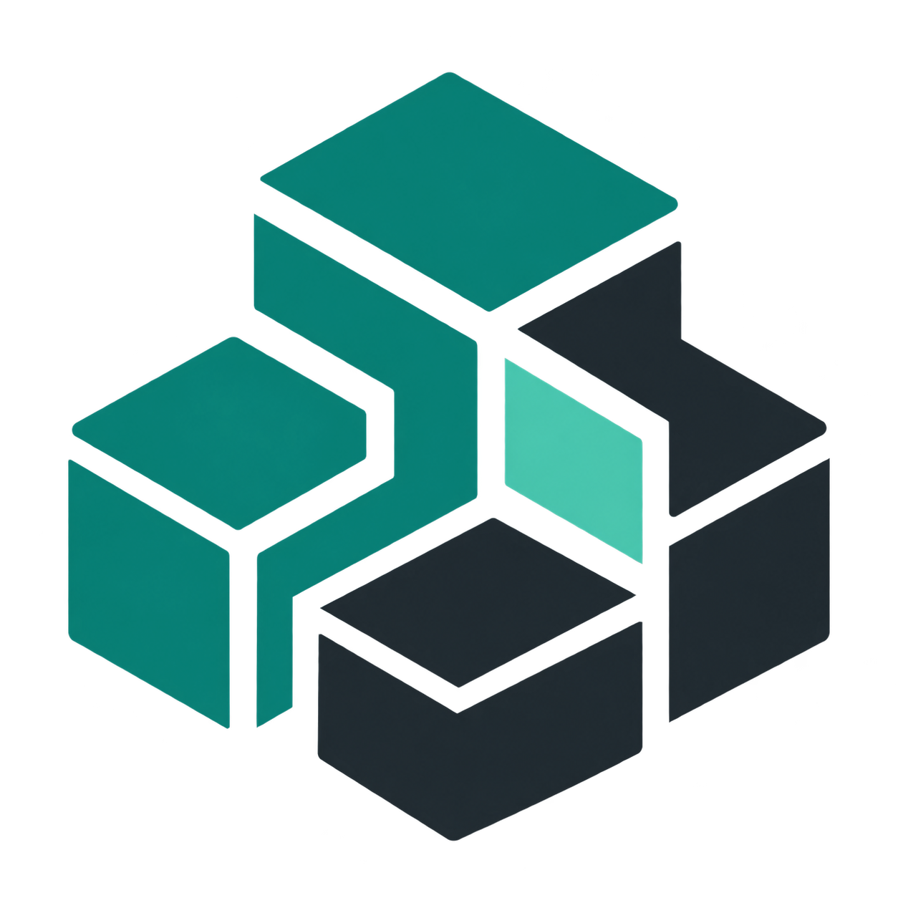
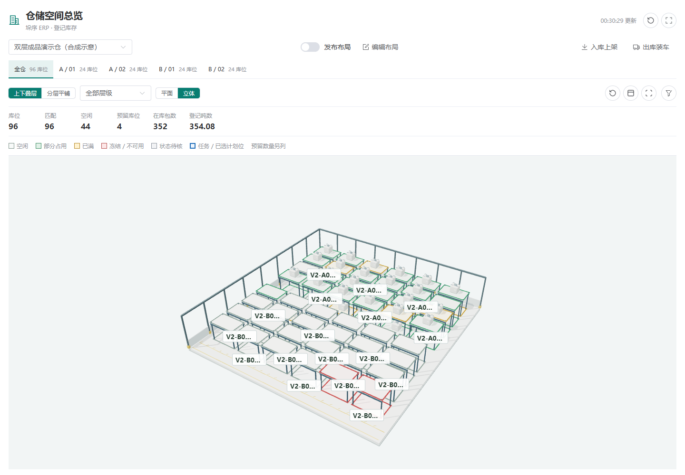
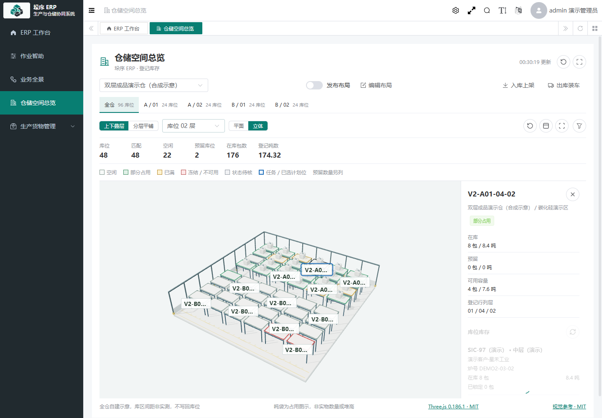
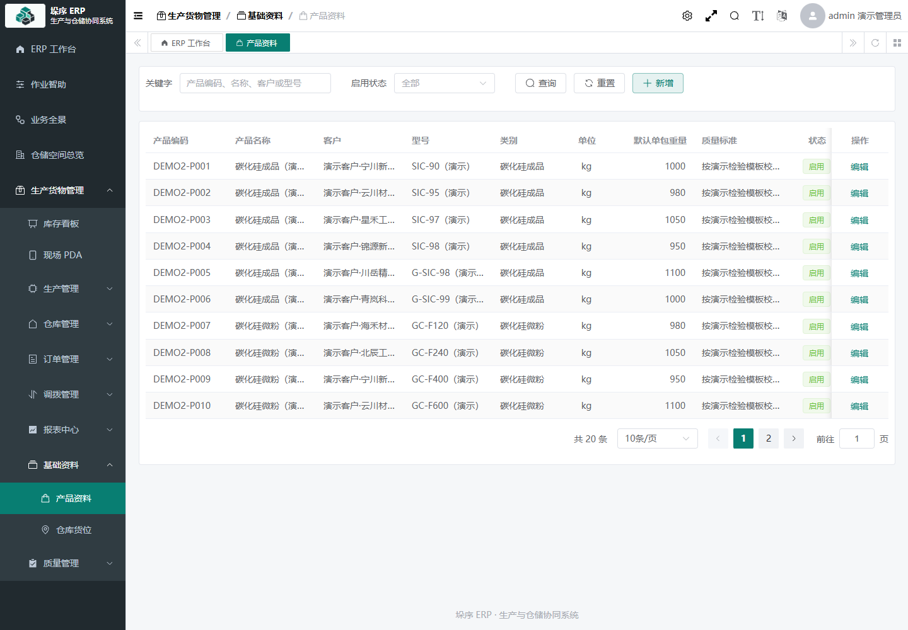
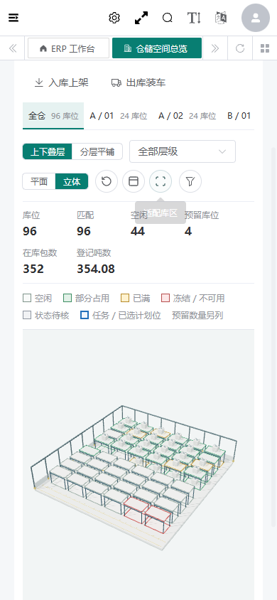
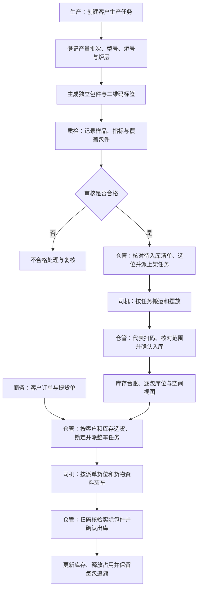
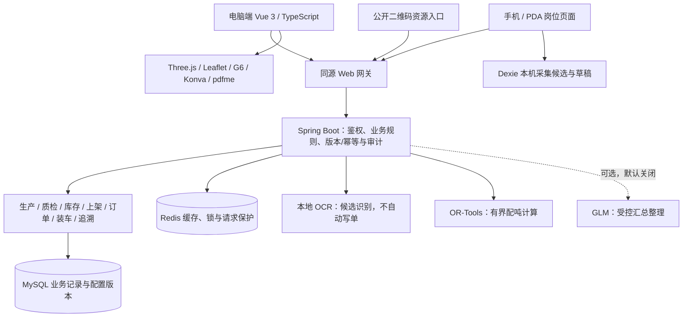

<p align="center">
  
</p>

# 垛序 ERP | DUOXU

**一包一码，批次协同，库存可视，全程可溯。**

垛序 ERP 是面向吨袋、批次型生产场景的生产与仓储协同系统。以客户生产任务为起点，为每一包货物建立独立身份，将生产、质检、上架、库位、库存、提货、整车装车和出库记录连接起来。电脑端负责计划、派单、审核与分析，手机/PDA 页面承接现场任务和扫码核验。

[在线演示](https://101.42.182.117/warehouse-space?warehouseCode=DEMO-SPACE-V2) · [快速启动](#快速启动) · [功能特色](#功能特色) · [业务流程](#业务流程) · [技术架构](#技术架构) · [文档导航](#文档导航)

当前产品品牌不绑定某一家使用企业，按独立单组织部署。仓库中保留的历史技术文档和包名不代表新产品的固定企业标识；客户、货物及单据资料仍以各部署实际记录为准。

## 在线演示与项目预览

访问 [垛序 ERP 演示站](https://101.42.182.117/login)，点击登录页的 **一键进入演示**。公开 `admin` 可操作合成业务数据，系统维护账号与权限独立保留。演示站用于体验，不应上传真实客户资料、生产文件或密钥。

建议按“仓储空间总览 → 产品资料 → 业务全景 → 包件追溯 → 现场 PDA → 作业智助”浏览。演示环境可能维护，下面的数据规模以 **2026-10-20 验证快照**为准，不作为实时统计。

| 演示内容     | 验证规模                                                                   |
| ------------ | -------------------------------------------------------------------------- |
| 产品资料     | 20 条，覆盖碳化硅成品/微粉、人造石墨、负极材料等演示品类                   |
| 包件         | 原 30 包 + 新增 480 包，共 510 包，每包独立身份与二维码                    |
| 库位         | 原 7 个 + 新增 96 个，共 103 个                                            |
| 双层演示仓   | `DEMO-SPACE-V2`，2 库区 × 4 排 × 6 列 × 2 层，上下层各 48 个               |
| 新增生产记录 | 20 个任务、60 个产量批次，包含待检、合格、不合格、待入库、在库及已出库场景 |
| 新仓在库     | 352 包 / 354.08 吨；510 是全部演示包件数量，不是全部在库数量               |

### 双层三维仓储空间



三维库位与 ERP 登记记录关联，支持上下叠层、分层平铺、指定层筛选、库区导航、旋转、全屏及点击详情。库位层级与生产炉层分别管理；模型是自建示意，不表示实测建筑、层高、承载能力或自动定位。

<details>
<summary>展开查看货位详情、产品资料和手机尺寸画面</summary>

**货位详情：** 选中上层货位后，查看在库包数、登记重量、预留、可用容量及关联货物。



**产品资料：** 产品编码、客户、型号、默认单包重量和质量标准统一维护。



**手机尺寸：** 同一仓库在 390 像素宽度下的页面与三维画布。



</details>

---

以上均为真实运行页面截图，数据为合成演示，不是工厂实景、真实订单或质量认证。截图来源及日期见 [素材说明](docs/assets/readme/README.md)。

## 功能特色

### 1. 一包一码，货物身份贯穿全流程

- 每包保留独立包号、二维码、登记重量和状态，关联生产任务、产量批次、客户、型号、炉号与炉层。
- 标签支持预览、打印、补打及原因记录；品牌或新包地址配置变化不重编历史包号、不覆盖已存二维码。
- 扫码既可查询货物，也可按登录岗位进入相应工作入口。公开信息与内部库存、客户和作业信息分开授权。

### 2. 扫一包识别批次，确认后批量处理

仓管扫描同一批次中的代表包，系统带出该批次或当前任务内符合条件的包件。核对清单、数量、重量和目标库位后，再确认本次实际处理范围。

- 保持一包一码，批次操作仍为每包留下独立记录。
- 一批分多个库位摆放时，按实际包件范围分别确认；部分出库时，未出包件保留原库存与位置。
- 代表扫码不是“扫一包就自动把整批过账”。不符合质检、任务、版本或库存条件的包件不能被一并放行。

### 3. 可视化连续扫码与本机待同步箱

相机连续扫码、图片解码与原批次代表扫码并行使用，展示已识别、本任务匹配、重复或错误包件及登记汇总。相机能力依赖 HTTPS/安全上下文、设备权限和清晰可见的二维码。

弱网时可保留本机采集候选和草稿，并区分本机已采集、服务器已确认、存在冲突。恢复网络后重新核对权限、任务版本与库存；离线采集不表示入库或出库成功，也不盲目重放结果不确定的请求。

### 4. 二维与三维库位协同

将登记库位组织为可交互空间视图，以颜色和文字区分空闲、占用、已满、冻结/不可用及待核状态。点击货位可查看原库存资料，查找包码可聚焦登记位置，任务可高亮计划或关联货位。

双层模式只对登记行列和层级完整、无冲突的数据对齐叠放；缺失信息保留平铺或待核，不猜位置。吨袋模型表示占用状态，不等于实物袋数、实际堆高或实时物理位置。已发布画布继续按发布内容展示。

### 5. 业务全景、追溯关系图与历史回放

- **业务全景：** 按生产任务汇总生产、质检、上架、库存、提货、装车及出库阶段，进入原单据与包件明细。
- **追溯关系图：** 将实际生产批次、包件、质检覆盖、库位、装车任务与出库单连成关系，按所选节点突出关联范围。
- **历史回放：** 依据实际流水展示任务的库存变化与历史证据，不把当前状态伪装成过去状态。

质检关联以实际覆盖成员为准，不因炉号相同就推定整炉货物都被同一次检验覆盖。

### 6. 作业智助：配吨、识单、布局与标签

| 工具         | 能做什么                                                 | 正式确认仍在哪里完成                   |
| ------------ | -------------------------------------------------------- | -------------------------------------- |
| 智能配吨     | 基于原提货单和真实可用包件，按目标重量、容差计算候选组合 | 仓管在原出库流程复核、选货、锁定与派单 |
| 本地 OCR     | 从图片或 PDF 提取单据信息，展示原文、候选与可修改草稿    | 人工核对后通过原业务表单提交           |
| 库位布局编辑 | 绑定真实库位，编辑展示位置，保存版本并发布               | 布局发布不更新货物位置或库存           |
| 标签模板     | 原包码预览、模板编辑/版本发布、PDF 标签生成              | 模板维护、首打和补打分别受原权限控制   |

配吨使用约束求解，不是大模型猜货；OCR 可本地运行，不需要把附件发给 GLM。详见 [作业智助说明](docs/product/作业智助使用与本地部署说明.md)。

### 7. 同一码提供网页与公开护照

稳定包码入口 `/pkg/{packageCode}` 可提供网页、公开快照、JSON-LD 机器文档及 Linkset 资源目录。公开快照可下载并在本机核对内容摘要，再与服务器当前公开记录比较。

公开投影不含客户、库位、人员、单据和内部自由备注。摘要核对用于内容一致性检查，不是电子签名、实物防伪或 GS1 认证。

### 8. 受控 AI 辅助，业务事实仍由 ERP 决定

内部包码页面提供基于 ERP 规则的状态、进度、风险核对和交接信息，并准备了 GLM 整理接口。本期获准外发的范围仅为流程状态、汇总包数/重量和受控解释键，不直接外发客户、包码、库位、单据号、人员或附件原件。

**当前 GLM 真实调用关闭。** 具体模型、费用上限和私密配置确认后才可启用。AI 不质检放行、不更新库位、不锁货、不确认出入库；输出由人结合业务依据核对。

## 业务流程

### 从客户生产任务到货物出库



### 现场责任与异常处理

1. 生产任务先明确客户，型号、炉号、炉层和包件信息随实际产量记录形成，不要求在生产任务上额外堆叠合同信息。
2. 质检记录明确样品与实际覆盖范围；未审核、待检或不合格包件不按可放行库存处理。
3. 仓管维护库位、执行扫码核验并负责最终确认；司机接任务、搬运、摆放和反馈，不承担扫码过账或修改库位责任。
4. 出库按整车任务派发货位和相关资料，不按型号/炉号/炉层另拆成多个装车小组；清单保留每包身份。
5. 少装、换货、扫码不符、质检异常、库位冲突或版本变化进入对应异常/核定流程，不静默改账。弱网或超时结果不确定时先核对回执。

## 模块与岗位

### 功能模块

| 模块           | 主要内容                                                    |
| -------------- | ----------------------------------------------------------- |
| ERP 工作台     | 库存入口、仓储空间主展示与岗位相关业务入口                  |
| 生产管理       | 客户生产任务、产量记录、批次与独立包件、标签打印            |
| 质量管理       | 抽检样品、覆盖成员、检验指标、提交/审核及不合格处理         |
| 仓库管理       | 上架派单、代表扫码、库位维护、库存台账/流水、装车及出库复核 |
| 订单管理       | 客户发货需求、订单履约、库存占用、提货单与发货关联          |
| 库存盘点与调拨 | 原盘点/调拨业务入口及相应记录、权限与核对流程               |
| 业务全景与追溯 | 阶段统计、包件明细、关系图、原单据与历史证据                |
| 作业智助       | 配吨、时间回放、本地 OCR、库位布局、标签模板                |
| 基础资料与报表 | 产品、客户关联、库位资料、库存统计与导出                    |
| 系统支撑       | 登录、角色权限、审计、文件及任务调度基础能力                |

### 七类演示角色

角色不是简单换菜单皮肤；页面入口、读取范围、可执行动作和服务器鉴权分别受控。以下为演示角色概览，具体以当前账号授权为准。

| 角色           | 主要使用范围                              | 责任边界                                   |
| -------------- | ----------------------------------------- | ------------------------------------------ |
| 私有维护管理员 | 用户、角色、部署维护与获授权业务          | 与公开演示账号隔离，不把维护凭据放到登录页 |
| 生产岗位       | 生产任务、产量、包件及标签相关作业        | 不代替质检审核或仓管库存确认               |
| 质检岗位       | 抽检、检验记录与质量反馈                  | 提交人与复核按原审核规则分工               |
| 仓管岗位       | 库位、上架、扫码核验、库存与装车/出库确认 | 对计划/实际库位与最终库存结果负责          |
| 叉车司机       | 本人上架/装车任务、搬运与异常反馈         | 不新增扫码、选位、库位维护或出入库确认权限 |
| 商务/销售      | 客户需求、订单、提货单及发货进度          | 发货需求与仓管实际执行/复核分开            |
| 只读查看者     | 获授权看板、空间视图及业务查询            | 不执行库存和单据维护动作                   |

公开 `admin` 是额外的业务演示入口，允许体验合成业务操作，不等同于私有维护管理员，也不通过赋予司机身份来扩大权限。

## 技术架构



### 技术栈与复用组件

| 层次      | 当前实现                                                                           |
| --------- | ---------------------------------------------------------------------------------- |
| 后端      | Java 17 编译目标、Spring Boot 2.7.18、Maven；已有基线使用 JDK 17 测试、JDK 21 打包 |
| 数据层    | MySQL、Redis、MyBatis/MyBatis-Plus，业务写入统一走原服务规则                       |
| 前端      | Vue 3、TypeScript、Vite、Element Plus、Pinia                                       |
| 空间视图  | Three.js 0.186.1、Leaflet 1.9.4，本地资源和自建示意几何                            |
| 二维码    | Vue Qrcode Reader、ZXing-WASM，支持原包码入口与图片解码                            |
| 关系/回放 | AntV G6、vis-timeline，使用真实关联和历史证据                                      |
| 采集草稿  | Dexie / IndexedDB，不取代服务器业务数据                                            |
| 布局/标签 | Konva、vue-konva、pdfme，展示配置与正式货物身份分离                                |
| 计算/识别 | OR-Tools、PaddleOCR；模型/运行环境按各自配置准备                                   |
| 部署      | Docker Compose 试运行方案；当前云演示使用独立 Linux 服务命名空间                   |

实际依赖版本以 [前端清单](frontend/package.json)、[锁文件](frontend/pnpm-lock.yaml)、[后端 BOM](backend/yudao-dependencies/pom.xml) 及各工具锁定文件为准。

### 工程结构

```text
backend/
  rd-erp-server/          Spring Boot 启动、配置与正式 JAR
  rd-erp-inventory/       生产、包件、质检、库存与出入库业务
  yudao-module-system/    精简后的用户、角色、认证与权限内核
  yudao-module-infra/     精简后的审计、文件与任务调度内核
  sql/mysql/             干净初始化、升级及专项结构脚本
frontend/
  src/views/rd/          业务页面、岗位 PDA、追溯与空间视图
  public/licenses/       前端运行资源的第三方通知
tools/document-ocr/      本地 OCR 服务、模型锁和测试
deploy/
  local-infra/           本机隔离基础设施
  trial/                 源码 / 运行时 Docker Compose
  cloud-demo/            独立合成云演示部署与核验
scripts/                 本地启动、备份、安全、发布与验证工具
docs/                    架构、产品说明、实施规格与验收记录
```

业务与应用代码使用 `com.ruiding.erp`，底层框架保留 `cn.iocoder.yudao.framework`。当前固定单组织 `tenant_id=1`，前端不提供租户管理/切换；不同企业部署应使用各自独立账号、数据库和数据边界，不把品牌化等同于多组织 SaaS。

## 快速启动

### 获取当前开发分支

```bash
git clone --branch feature/warehouse-pda-next-phase https://github.com/Ring0321/rd-production-inventory-erp.git
cd rd-production-inventory-erp
```

### 方式一：Docker Compose 源码试运行

准备 Docker Engine 24+、Docker Compose v2 和可用的依赖下载网络。在仓库根目录执行：

```powershell
Copy-Item deploy/trial/.env.example deploy/trial/.env
# 启动前编辑 deploy/trial/.env，替换全部密码占位符，并核定可达的二维码地址。
```

至少配置以下内容，不能直接使用示例占位值上线：

| 环境变量                    | 用途                                                |
| --------------------------- | --------------------------------------------------- |
| `RD_DB_PASSWORD`            | 数据库密码，与其他密码分别生成                      |
| `RD_REDIS_PASSWORD`         | Redis 密码                                          |
| `RD_ADMIN_INITIAL_PASSWORD` | 首次管理员密码；初始化基线不含通用默认密码          |
| `RD_DIGITAL_LINK_BASE_URL`  | 真实可达地址，例如 `https://your-host.example/pkg`  |
| `RD_PUBLIC_TENANT_ID`       | 本独立部署组织，当前初始化为 `1`                    |
| `RD_WEB_PORT`               | 本地 Web 端口，默认 `9000`；占用时换用空闲端口      |
| `RD_CAPTCHA_ENABLED`        | 内网试运行配置；公网/正式上线需核定并回归验证码策略 |

确认配置后执行：

```bash
docker compose --env-file deploy/trial/.env -f deploy/trial/compose.yaml build
docker compose --env-file deploy/trial/.env -f deploy/trial/compose.yaml up -d
docker compose --env-file deploy/trial/.env -f deploy/trial/compose.yaml ps
```

本机默认访问 `http://127.0.0.1:9000/login`。对外仅开放 Web，MySQL、Redis 和后端保留在 Compose 内网。Compose 主链路不自动启用 OCR 模型或 GLM，相关能力按专项说明配置。

新包二维码使用可达基址，历史包优先保留已存地址。若要用手机扫码，不能把手机端的 `localhost` 当作服务器；需配置实际网络地址和 HTTPS，并单独测试设备访问与相机权限。

完整步骤、无源码运行包、升级与回滚见 [试运行部署说明](deploy/trial/README.md)。已有数据库不能重新导入干净初始化脚本，先备份、隔离恢复核对，再按升级路径执行。

### 方式二：Windows 本机开发启动

准备可用的 Java、Maven、Node.js 和 pnpm。基础设施可选择 Docker，或按本机说明准备独立 MySQL 与 Redis 兼容服务；启动器不会把已有系统数据库当作新库重置。

```powershell
powershell -ExecutionPolicy Bypass -File scripts/local/Start-RdErpLocal.ps1
powershell -ExecutionPolicy Bypass -File scripts/local/Get-RdErpLocalStatus.ps1
```

首次启动生成本机随机密码，保存在被 Git 忽略的本地环境文件中，不在 README 提供默认密码。本机停止并保留数据：

```powershell
powershell -ExecutionPolicy Bypass -File scripts/local/Stop-RdErpLocal.ps1
```

支持独立实例名及数据库、Redis、后端、Web 端口参数；存在其他服务时先检查端口，不强行停止原服务。详见 [本地基础设施说明](deploy/local-infra/README.md)。

### 源码构建与测试

前端要求以 `package.json` 为准：Node.js `>=20.19.0`、pnpm `>=8.6.0`；源码容器使用 Node 22 与 pnpm 10.15.1。保留锁文件，避免无意升级依赖。

```powershell
cd frontend
pnpm install --frozen-lockfile
node --test
pnpm ts:check
pnpm build:prod
```

后端在仓库 `backend` 目录执行；Java 环境按上述已验证测试/打包基线选择：

```powershell
cd backend
mvn -pl rd-erp-server -am test
mvn -pl rd-erp-server -am -DskipTests package
```

上面两组命令分别从仓库根目录进入对应目录执行，不是在 `frontend` 目录继续 `cd backend`。正式产物为 `backend/rd-erp-server/target/rd-erp-server.jar` 与 `frontend/dist-prod/`。

云部署工具单测在仓库根目录运行：

```powershell
python -m unittest discover -s deploy/cloud-demo -p "test*.py"
```

OCR 使用独立 Python 3.12 环境及固定模型，启动和验证见 [OCR 模块说明](tools/document-ocr/README.md)。不要因主系统启动成功就认定模型、原生计算库或所有设备能力均可用。

## 数据、安全与部署

### 库存事实与操作保护

- 库存、质检、包件与原单据以服务器 ERP 为准；空间模型、关系图、AI、OCR 和本机草稿不另建一套货物真相。
- 关键动作按原权限、任务版本和幂等规则核对；请求结果不确定时保留待核，不自动当作成功或重新发起过账。
- 自建示意布局不改货物位置；预留不是入库，在装车但未最终出库的货物仍按原库存/锁定规则处理。
- 展示层筛选不更新库存。客户、组织和历史二维码资料不能因换品牌被批量替换。

### 私密配置与升级

- 凭据只由私密环境配置或密钥管理注入，不写入源码、SQL、日志、截图和发布 ZIP。
- 新环境使用 [干净初始化 SQL](backend/sql/mysql/rd_erp_clean.sql)；已有环境走 [升级 SQL](backend/sql/mysql/rd_erp_upgrade_slim.sql)，先备份并在隔离库验证。
- 前端 `VITE_*` 会进入浏览器构建产物，只能放公开配置，不能放数据库、GLM 或私有维护密钥。
- 原始生产数据、真实客户附件、数据库备份及 SSH 私钥不提交 Git。
- 日常停止不能使用会删除数据卷的重建命令。数据库恢复须先核对期间新增业务，不用旧备份覆盖未知新记录。

### 当前云演示

当前演示部署使用独立应用目录、账号、数据库、Redis、端口与服务命名空间，备份、健康检查和短期 IP 证书维护也限定在本应用。此次 README 更新不重新部署应用、不修改服务器原系统。

有关增量发布、公开演示账号、HTTPS、备份恢复和多系统隔离，见 [云演示部署说明](deploy/cloud-demo/README.md)；漏洞与敏感信息处理见 [SECURITY.md](SECURITY.md)。

## 验证记录与后续方向

截至 2026-10-20，双层演示扩容已完成以下验证，详细口径见 [本次验收记录](docs/acceptance/云端演示扩容与双层库位验收记录-20261020.md)：

| 范围           | 已有证据                                                                                 |
| -------------- | ---------------------------------------------------------------------------------------- |
| 前端回归       | 503 项 Node 测试通过，类型检查、改动文件规范及正式构建通过                               |
| 部署工具       | 17 项 Python 单测通过；种数检查点、防重发与重复执行核对                                  |
| 角色与业务 API | 7 类角色登录、原任务 30 包/22 笔流水、原布局/标签、配吨、追溯及 HTTPS OCR 回归           |
| 浏览器         | 1440×1000、390×844、320×760 实际画面与 WebGL 像素、旋转、分层、详情、全屏及二维/三维切换 |
| 导航与登录     | 一键进入演示、刷新、PDA 返回 ERP、退出重登及匿名访问重定向                               |
| 数据与隔离     | 原记录保留；重复种数六表指纹不变；原系统受保护服务/关键文件未改动                        |

这是对应版本的演示与技术验证，不是长期在线率、全平台零漏洞或全部工厂验收承诺。后续工作按 [总开发计划](docs/ERP下一阶段详细开发计划-入库出库PDA闭环.md) 逐项推进：

- 完善原入库/出库和异常核定中尚未关闭的 C5/C6 项目。
- 采购或确认打印机、PDA、标签介质后，进行实体扫码、打印、真触摸性能、厂区网络及岗位签字验收。
- 核定 GLM 模型、费用上限和私密配置，开展受控真实调用与账单核对。
- 采购、原料仓、生产领退料及财务扩展按业务核定分阶段接入，不将方案文件写成已上线模块。
- 企事通、智行导引/执行导引作为配套协同方向另行实施，不作为本仓库已完成的子系统展示。

## 文档导航

| 想了解什么                     | 文档                                                                                                                        |
| ------------------------------ | --------------------------------------------------------------------------------------------------------------------------- |
| 产品定位、品牌配置与二维码部署 | [产品部署与品牌配置](docs/product/垛序ERP部署与品牌配置.md)                                                                 |
| 业务边界与完整逻辑             | [全业务详细逻辑架构](docs/瑞鼎ERP全业务详细逻辑架构.md)                                                                     |
| 既有技术与运维基线             | [瘦身后开发与运维基线](docs/瑞鼎ERP瘦身后开发与运维基线.md)                                                                 |
| 岗位培训                       | [岗位操作培训手册](docs/岗位操作培训手册.md)，历史描述与当前责任不一致时以总计划最新规则为准                                |
| 连续扫码、关系图、弱网草稿     | [二维码作业增强规格](docs/二维码作业增强专项实施规格.md)                                                                    |
| 同码资源、公开快照与内容核对   | [二维码链接深化规格](docs/GitHub赋能调研与二维码链接深化实施规格.md)                                                        |
| 配吨、OCR、布局与标签模板      | [作业智助使用说明](docs/product/作业智助使用与本地部署说明.md)                                                              |
| AI 数据范围与启用条件          | [AI 接口与扫码问货规格](docs/AI国内接口与扫码问货实施规格.md)                                                               |
| 双层仓库及数据扩容             | [实施规格](docs/云端演示扩容与双层库位实施规格.md) · [验收记录](docs/acceptance/云端演示扩容与双层库位验收记录-20261020.md) |
| 本机运行与容器试运行           | [本地基础设施](deploy/local-infra/README.md) · [Compose 部署](deploy/trial/README.md)                                       |
| 云端演示部署                   | [独立云演示说明](deploy/cloud-demo/README.md)                                                                               |
| 备份、安全与发布               | [备份脚本](scripts/backup/README.md) · [安全工具](scripts/security/README.md) · [发布工具](scripts/release/README.md)       |
| 下一步开发与未关闭事项         | [总开发计划](docs/ERP下一阶段详细开发计划-入库出库PDA闭环.md)                                                               |

部分文档沿用早期项目名称与当时进度，按文档日期阅读；当前云演示和岗位边界以最新验收/总计划说明为准。

## 参与开发与许可

提交前先确认目标分支和现有改动，围绕单一业务范围修改，增加相应测试与验收说明。涉及库存、质检、扫码、库位或出库时，尤其检查权限、重复请求、版本变化、部分包件与异常恢复；不要用展示层便利跳过原业务确认。

感谢复用的基础框架及 Three.js、Leaflet、Vue Qrcode Reader、ZXing-WASM、AntV G6、Dexie、OR-Tools、PaddleOCR、Konva、pdfme、vis-timeline 等项目。依赖与上游版权通知随原文件保留：

- [后端原许可证](backend/LICENSE)
- [前端运行资源许可](frontend/public/licenses/)
- [OCR 来源与模型说明](tools/document-ocr/THIRD_PARTY.json)
- [前端依赖与授权声明](frontend/package.json)

后端许可证与前端 `UNLICENSED` 声明分别保留，不把单个 MIT/BSD/Apache 依赖的许可概括为整个系统的统一授权。复用和分发前请逐项核对代码、模型、字体、图标及上游必要通知；产品名称不代表商标注册或正式商业验收。
