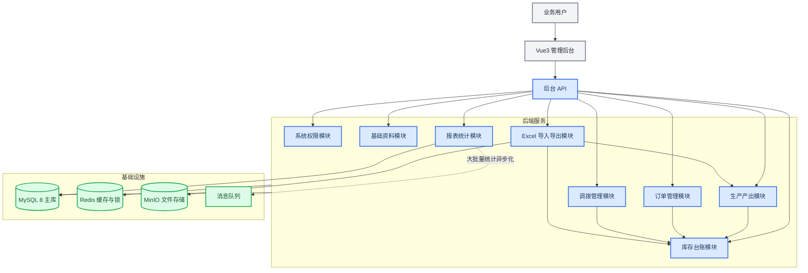
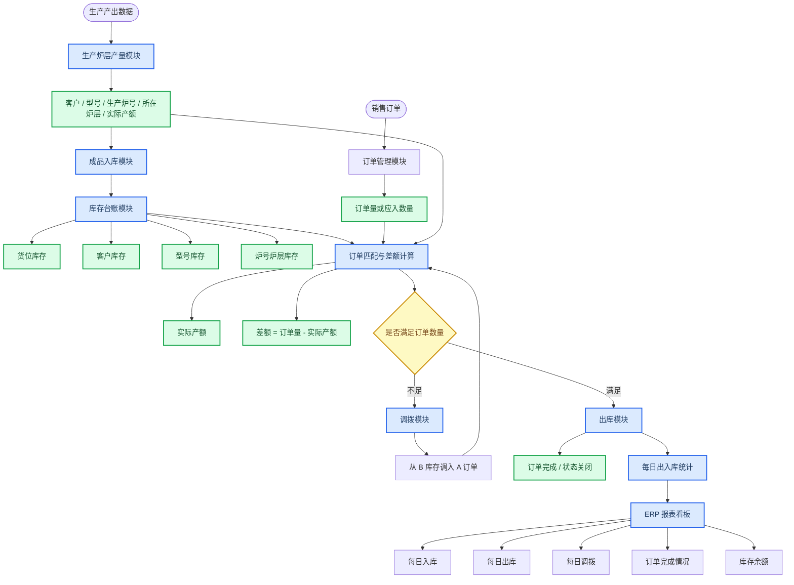
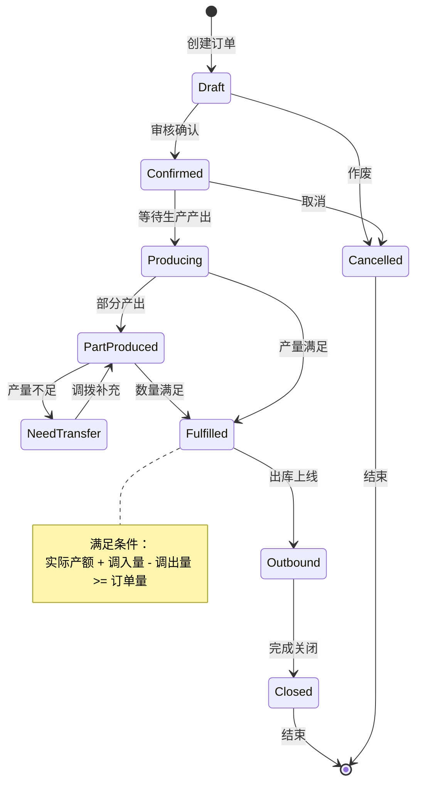
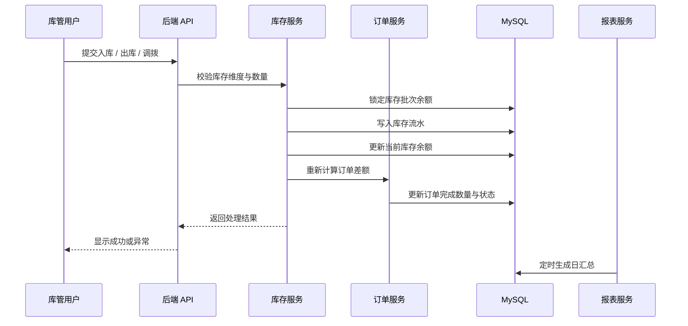
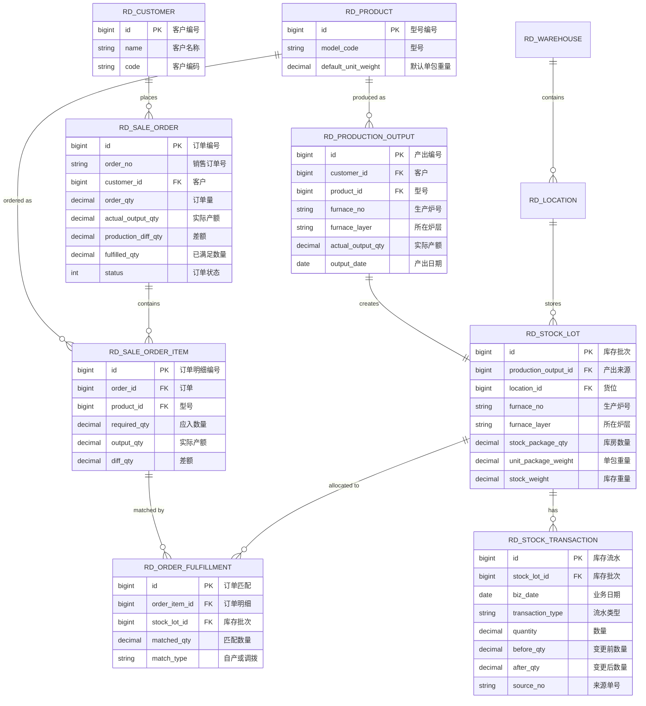
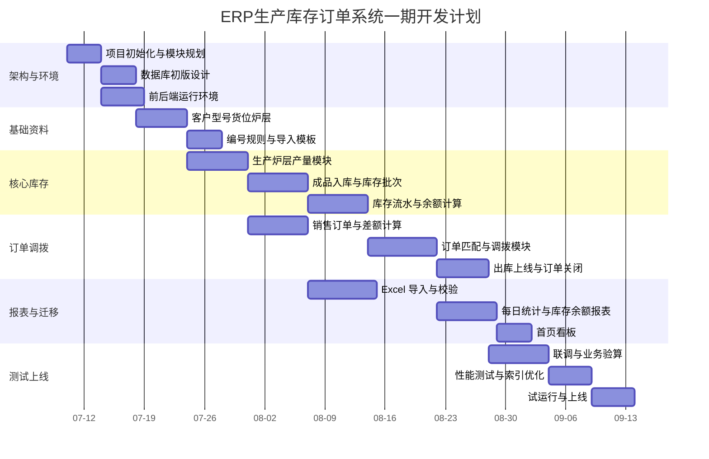

# ERP生产库存订单管理系统开发方案

_面向“生产炉层产出 -> 成品入库 -> 库房库存 -> 订单调拨与完成 -> 每日出入库统计”的企业级 ERP 二开方案，日期：2026-07-09。_

---

## 目录

- [项目目标](#项目目标)
- [业务范围](#业务范围)
- [总体架构](#总体架构)
- [技术选型](#技术选型)
- [模块设计](#模块设计)
- [核心业务流程](#核心业务流程)
- [数据库设计](#数据库设计)
- [接口设计](#接口设计)
- [前端页面设计](#前端页面设计)
- [数据量与性能方案](#数据量与性能方案)
- [权限与审计](#权限与审计)
- [开发计划](#开发计划)
- [验收标准](#验收标准)
- [风险与决策](#风险与决策)

---

## 项目目标

本系统用于替代当前 Excel 方式管理生产后库存，重点解决生产成品从炉层产出到库房存储、出库、调拨、订单完成之间的数量关系。系统需要完整保留每一条库存来源，不能因为订单完成而删除历史数据。

核心目标如下：

- 建立以 `客户 + 型号 + 生产炉号 + 所在炉层 + 货位` 为核心维度的库存台账
- 支持生产产出入库、每日出库、退货、调拨、期初库存、库存重量自动计算
- 支持销售订单的 `订单量`、`实际产额`、`差额`、`调拨后差额` 自动计算
- 支持 A 订单数量不足时，从 B 库存调拨补足，订单满足后自动关闭
- 支持每日入库、每日出库、每日调拨、订单完成情况、库存余额报表
- 兼容现有 Excel 的字段与统计口径，并逐步迁移到数据库台账

> 订单“划掉”在系统内不做物理删除，而是改为 `已完成` 状态，并在页面上用完成状态或删除线展示。历史入库、出库、调拨、关闭记录必须保留，方便追溯。

---

## 业务范围

### 一期范围

| 业务域 | 一期功能 | 说明 |
| --- | --- | --- |
| 基础资料 | 客户、型号、仓库、货位、炉层字典 | 保证 Excel 字段可标准化录入 |
| 生产产出 | 生产炉号、所在炉层、实际产额录入 | 一条炉层产出形成一条库存来源 |
| 成品入库 | 按日期、客户、型号、炉号、炉层入库 | 生成库存台账和库存流水 |
| 库存管理 | 期初、入库、出库、退货、调拨、库房数量、库存重量 | 以流水计算余额，避免手工改汇总 |
| 订单管理 | 订单量、实际产额、差额、订单状态 | 根据产量和调拨量自动更新 |
| 调拨管理 | 从 B 库存调入 A 订单 | 形成调出、调入两条库存流水 |
| 出库管理 | 每日出库上线 | 按订单、客户、型号、炉号、炉层出库 |
| 报表看板 | 每日入库、每日出库、每日调拨、订单完成、库存余额 | 仿照当前 ERP 首页与表格风格 |
| Excel 迁移 | 历史 Excel 导入、字段映射、校验 | 先导入 staging，再入正式台账 |

### 暂缓范围

| 业务域 | 暂缓原因 |
| --- | --- |
| 完整财务核算 | 当前重点是库存数量和订单完成，不先做金额闭环 |
| 生产过程 MES 全流程 | 先接收生产结果，不先管工序排产 |
| 供应商采购 | 本次聚焦生产后的成品库存 |
| 多工厂多组织复杂核算 | 二期再根据组织规模扩展 |

---

## 总体架构

系统底座建议使用已拉取的 `ruoyi-vue-pro` 后端与 `yudao-ui-admin-vue3` 前端，新增自定义业务模块 `rd-inventory`。`jshERP` 作为页面和进销存交互参考，不作为主开发底座。



### 项目目录建议

```text
open-source-erp/
├── ruoyi-vue-pro/                  # 后端主工程
│   ├── yudao-module-system/        # 用户、角色、菜单、权限
│   ├── yudao-module-infra/         # 代码生成、文件、配置、日志
│   ├── yudao-module-erp/           # 可参考或复用 ERP 通用对象
│   ├── yudao-module-wms/           # 可参考或复用 WMS 仓库对象
│   └── yudao-module-rd-inventory/  # 建议新增：瑞鼎生产库存订单模块
├── yudao-ui-admin-vue3/            # Vue3 管理后台
│   └── src/views/rd/               # 建议新增：瑞鼎业务页面
└── jshERP/                         # 参考项目：进销存页面与单据交互
```

---

## 技术选型

### 主选型

| 层级 | 技术 | 选择理由 |
| --- | --- | --- |
| 前端 | Vue3、Vite、TypeScript、Element Plus | 与已拉取 `yudao-ui-admin-vue3` 匹配，适合管理后台表格、表单、报表 |
| 后端 | Java、Spring Boot、MyBatis Plus | 与 `ruoyi-vue-pro` 匹配，权限、菜单、导入导出、代码生成可复用 |
| 数据库 | MySQL 8.0 | 订单、库存、流水属于强事务关系型数据，MySQL 足够作为一期主库 |
| 缓存与锁 | Redis、Redisson | 用于库存扣减锁、订单完成状态缓存、热点字典缓存 |
| 文件存储 | MinIO 或本地文件服务 | 存 Excel 原始文件、导入结果、导出报表 |
| 报表 | MySQL 汇总表 + ECharts | 一期足够，后期大数据量再接 ClickHouse |
| 部署 | Nginx、Docker Compose 起步 | 初期部署简单，后期可迁移 Kubernetes |

### 数据库是否只用 MySQL

MySQL 8.0 可以作为主数据库，但必须按企业级库存系统方式设计：

- 库存流水只追加，不随意覆盖
- 库存余额表保存当前余额，流水表保存过程
- 大流水表按月份或日期分区
- 高频查询建立组合索引
- 报表使用日汇总表和月汇总表，避免每次扫全量流水
- 大导出任务异步执行，避免阻塞在线业务

当 `stock_transaction` 超过 5000 万到 1 亿行，且报表查询明显变慢时，再增加 ClickHouse 或 Doris 做分析库。不要一开始引入过重的分析系统。

---

## 模块设计

### 模块清单

| 模块 | 功能 | 关键字段 |
| --- | --- | --- |
| 基础资料 | 客户、型号、仓库、货位、炉层、单包重量 | 客户、型号、货位、单包重量 |
| 生产产出 | 录入生产炉号、所在炉层、实际产额 | 生产炉号、所在炉层、实际产额 |
| 成品入库 | 将生产产出转入库房 | 入库日期、入库数量、库房数量 |
| 库存台账 | 维护当前库存余额和历史流水 | 期初、入库、出库、退货、调拨、库存重量 |
| 销售订单 | 管理订单量、需求数量、完成状态 | 订单量、实际产额、差额 |
| 订单匹配 | 将库存批次匹配到订单 | 订单编号、库存批次、匹配数量 |
| 调拨管理 | A 单不足时从 B 库存调拨 | 调出方、调入方、调拨数量 |
| 出库上线 | 每日出库扣减库存 | 出库日期、出库数量、订单编号 |
| 报表看板 | 日统计、订单完成、库存余额 | 每日入库、每日出库、每日调拨 |
| Excel 导入 | 现有表格导入、校验、生成台账 | 来源文件、来源行号、校验结果 |

### Excel 字段映射

| Excel 字段 | 系统字段 | 说明 |
| --- | --- | --- |
| 货位 | `location_code` | 建议独立库位表，不放备注 |
| 客户 | `customer_id`、`customer_name` | 客户主数据 |
| 型号 | `product_id`、`model_code` | 型号作为产品或 SKU |
| 生产炉号 | `furnace_no` | 生产批次核心维度 |
| 所在炉层 | `furnace_layer` | 例如上层、中层、下层、表皮 |
| 订单量 | `order_qty` | 销售订单应入数量 |
| 实际产额 | `actual_output_qty` | 生产实际产出 |
| 差额 | `production_diff_qty` | `订单量 - 实际产额` |
| 期初 | `opening_qty` | 初始库存数量 |
| 调拨 | `transfer_qty` | 调入为正，调出为负，报表可拆分 |
| 入库 | `in_qty` | 生产入库或其他入库 |
| 出库 | `out_qty` | 上线或销售出库 |
| 退货 | `return_qty` | 退货入库 |
| 库房数量 | `stock_package_qty` | 当前包数或库存数量 |
| 单包重量 | `unit_package_weight` | 每包重量 |
| 库存重量 | `stock_weight` | `库房数量 * 单包重量` |

---

## 核心业务流程

### 生产到库存到订单完成流程



### 订单状态流转



### 库存出入库时序



---

## 数据库设计

### 设计原则

- 库存余额和库存流水分开
- 每一次入库、出库、退货、调拨都必须形成流水
- 货位、客户、型号、生产炉号、所在炉层是库存批次的正式维度
- Excel 日期列不直接建成数据库列，而是转成 `biz_date + transaction_type + quantity` 的流水行
- 订单完成只改状态，不删除订单与库存流水

### 核心实体关系



### 关键表说明

| 表名 | 作用 | 重要索引 |
| --- | --- | --- |
| `rd_customer` | 客户主数据 | `code`、`name` |
| `rd_product` | 型号主数据 | `model_code` |
| `rd_location` | 货位主数据 | `warehouse_id + location_code` |
| `rd_production_output` | 生产炉层产量 | `customer_id + product_id + furnace_no + furnace_layer` |
| `rd_stock_lot` | 当前库存批次余额 | `location_id + customer_id + product_id + furnace_no + furnace_layer` |
| `rd_stock_transaction` | 库存流水明细 | `biz_date`、`stock_lot_id + biz_time`、`transaction_type + biz_date` |
| `rd_sale_order` | 销售订单主表 | `order_no`、`customer_id + status` |
| `rd_sale_order_item` | 销售订单明细 | `order_id + product_id` |
| `rd_order_fulfillment` | 订单与库存批次匹配 | `order_item_id`、`stock_lot_id` |
| `rd_daily_stock_summary` | 日库存汇总 | `summary_date + customer_id + product_id` |

### 计算公式

| 字段 | 公式 |
| --- | --- |
| `库存重量` | `库房数量 * 单包重量` |
| `差额` | `订单量 - 实际产额` |
| `调拨后差额` | `订单量 - (实际产额 + 调入量 - 调出量)` |
| `库房数量` | `期初 + 入库 + 调入 - 出库 - 调出 + 退货 + 盘盈 - 盘亏` |
| `订单满足数量` | `自产匹配数量 + 调拨匹配数量 - 已出库冲减异常数量` |
| `订单完成条件` | `订单满足数量 >= 订单量` |

### 库存流水类型

| 类型 | 方向 | 说明 |
| --- | --- | --- |
| `OPENING` | 增加 | 期初库存 |
| `PRODUCTION_IN` | 增加 | 生产成品入库 |
| `OUTBOUND` | 减少 | 出库上线 |
| `RETURN_IN` | 增加 | 退货入库 |
| `TRANSFER_IN` | 增加 | 调拨入库 |
| `TRANSFER_OUT` | 减少 | 调拨出库 |
| `ADJUST_IN` | 增加 | 盘盈或修正增加 |
| `ADJUST_OUT` | 减少 | 盘亏或修正减少 |

---

## 接口设计

接口路径建议统一放在 `/admin-api/rd` 下，和若依后台权限体系保持一致。

### 生产产出接口

| 方法 | 路径 | 用途 |
| --- | --- | --- |
| `GET` | `/admin-api/rd/production-outputs/page` | 分页查询炉层产量 |
| `POST` | `/admin-api/rd/production-outputs` | 新增生产产出 |
| `PUT` | `/admin-api/rd/production-outputs/{id}` | 修改未入库产出 |
| `POST` | `/admin-api/rd/production-outputs/{id}/stock-in` | 生产产出转入库 |
| `POST` | `/admin-api/rd/production-outputs/import` | Excel 导入生产产出 |

### 库存接口

| 方法 | 路径 | 用途 |
| --- | --- | --- |
| `GET` | `/admin-api/rd/stocks/page` | 分页查询库存批次 |
| `GET` | `/admin-api/rd/stocks/transactions/page` | 查询库存流水 |
| `POST` | `/admin-api/rd/stocks/outbound` | 出库上线 |
| `POST` | `/admin-api/rd/stocks/return-in` | 退货入库 |
| `POST` | `/admin-api/rd/stocks/adjust` | 库存调整 |

### 订单与调拨接口

| 方法 | 路径 | 用途 |
| --- | --- | --- |
| `GET` | `/admin-api/rd/sale-orders/page` | 销售订单分页 |
| `POST` | `/admin-api/rd/sale-orders` | 新增销售订单 |
| `POST` | `/admin-api/rd/sale-orders/{id}/match` | 订单匹配库存 |
| `POST` | `/admin-api/rd/transfers` | 创建调拨单 |
| `POST` | `/admin-api/rd/transfers/{id}/audit` | 审核并执行调拨 |
| `POST` | `/admin-api/rd/sale-orders/{id}/close` | 手动关闭订单 |

### 报表接口

| 方法 | 路径 | 用途 |
| --- | --- | --- |
| `GET` | `/admin-api/rd/reports/daily-stock` | 每日入库、出库、调拨 |
| `GET` | `/admin-api/rd/reports/order-completion` | 订单完成情况 |
| `GET` | `/admin-api/rd/reports/stock-balance` | 库存余额 |
| `POST` | `/admin-api/rd/reports/export` | 异步导出报表 |

---

## 前端页面设计

页面风格仿照当前 ERP：左侧深色菜单、顶部工具栏、页签导航、查询筛选区、表格主区、右侧或底部统计汇总。

### 菜单结构

```text
首页
生产管理
  生产炉层产量
  成品入库
订单管理
  销售订单
  订单匹配
仓库管理
  库存台账
  出库上线
  调拨单
  退货入库
  库存调整
报表中心
  每日出入库统计
  订单完成情况
  库存余额
  炉号炉层明细
基础资料
  客户资料
  型号资料
  仓库货位
  炉层字典
系统配置
  用户权限
  导入模板
  编号规则
```

### 核心列表字段

库存台账主表必须显示以下字段：

| 字段 | 是否一期必做 | 说明 |
| --- | --- | --- |
| 货位 | 是 | 对应 Excel 第一列 |
| 客户 | 是 | 支持筛选 |
| 型号 | 是 | 支持筛选 |
| 生产炉号 | 是 | 支持精确查询 |
| 所在炉层 | 是 | 支持多选 |
| 订单量 | 是 | 来自销售订单 |
| 实际产额 | 是 | 来自生产产出 |
| 差额 | 是 | 自动计算 |
| 期初 | 是 | 支持初始化 |
| 调拨 | 是 | 可展示净调拨或拆分调入调出 |
| 入库 | 是 | 按日期统计 |
| 出库 | 是 | 按日期统计 |
| 退货 | 是 | 退货入库 |
| 库房数量 | 是 | 当前包数或数量 |
| 单包重量 | 是 | 型号默认，可按批次覆盖 |
| 库存重量 | 是 | 自动计算 |

### 交互要求

- 表格必须服务端分页，不一次性加载所有数据
- 查询条件至少包含日期、货位、客户、型号、生产炉号、所在炉层、订单状态
- 完成订单保留在列表中，可按状态隐藏或显示
- 完成订单可显示删除线，但不能删除数据
- 每个数量字段可点击查看来源流水
- Excel 导入必须先预览错误，再确认入库

---

## 数据量与性能方案

### 数据增长预估

| 数据类型 | 增长来源 | 设计方式 |
| --- | --- | --- |
| 生产产出 | 每日炉号、炉层、客户、型号组合 | 正式业务表，按日期和炉号索引 |
| 库存流水 | 入库、出库、调拨、退货都会增加 | 只追加，按月分区 |
| 库存余额 | 当前可用库存 | 单独余额表，实时更新 |
| 日报表 | 每日统计 | 定时汇总表 |
| Excel 导入记录 | 每次导入保留来源 | 原始文件入对象存储，明细入 staging 表 |

### MySQL 索引建议

```sql
-- 库存批次快速定位
CREATE INDEX idx_stock_lot_dimension
ON rd_stock_lot (customer_id, product_id, furnace_no, furnace_layer, location_id);

-- 按日期统计库存流水
CREATE INDEX idx_stock_transaction_date_type
ON rd_stock_transaction (biz_date, transaction_type);

-- 查询某批次流水
CREATE INDEX idx_stock_transaction_lot_time
ON rd_stock_transaction (stock_lot_id, biz_time);

-- 订单状态列表
CREATE INDEX idx_sale_order_customer_status
ON rd_sale_order (customer_id, status);

-- 订单匹配追溯
CREATE INDEX idx_order_fulfillment_order_item
ON rd_order_fulfillment (order_item_id, stock_lot_id);
```

### 并发控制

| 场景 | 控制方式 |
| --- | --- |
| 同一库存批次同时出库 | 数据库行锁 + version 乐观锁 |
| 同一订单同时匹配 | Redis 分布式锁，锁 key 为 `order:{id}` |
| Excel 重复导入 | 文件 checksum + 来源行号幂等键 |
| 调拨执行失败 | 事务内同时写调出、调入、流水、订单重算 |
| 大报表导出 | 异步任务，完成后下载文件 |

### 报表策略

- 在线列表查询使用明细表分页
- 首页卡片和趋势图读取日汇总表
- 每日统计按 `biz_date` 汇总
- 月度统计由日汇总表二次汇总
- 超大范围查询转为后台导出任务

---

## 权限与审计

### 角色建议

| 角色 | 权限 |
| --- | --- |
| 系统管理员 | 用户、角色、菜单、基础配置 |
| 库管 | 入库、出库、调拨、库存查询 |
| 生产录入 | 生产产出录入、导入、查看 |
| 订单专员 | 销售订单、订单匹配、订单关闭 |
| 审核员 | 调拨审核、库存调整审核 |
| 只读管理 | 看板、报表、导出 |

### 审计要求

必须记录以下行为：

- 生产产出新增、修改、作废
- 入库、出库、调拨、退货、库存调整
- 销售订单新增、修改、关闭
- Excel 导入、导入确认、导入失败
- 库存数量发生变化前后的数量
- 操作人、操作时间、来源单号、备注

---

## 开发计划

### 总体周期

建议一期按 8 到 10 周执行。若历史 Excel 数据清洗复杂，预留 2 周缓冲。



### 阶段交付物

| 阶段 | 时间 | 交付物 |
| --- | --- | --- |
| 第 1 阶段 | 第 1 周 | 项目结构、数据库初稿、菜单草图、接口清单 |
| 第 2 阶段 | 第 2 周 | 基础资料页面、货位和型号管理、导入模板 |
| 第 3 阶段 | 第 3 到 4 周 | 生产产出、成品入库、库存批次、库存流水 |
| 第 4 阶段 | 第 5 到 6 周 | 订单量、实际产额、差额、调拨、订单关闭 |
| 第 5 阶段 | 第 7 周 | 每日入库、每日出库、每日调拨、库存余额报表 |
| 第 6 阶段 | 第 8 周 | Excel 历史数据迁移、业务验算、权限审计 |
| 第 7 阶段 | 第 9 到 10 周 | 性能测试、试运行、上线文档、培训材料 |

### 开发优先级

| 优先级 | 功能 | 原因 |
| --- | --- | --- |
| P0 | 库存批次、库存流水、订单差额 | 系统核心，必须先稳定 |
| P0 | Excel 导入与数据验算 | 需要承接现有业务数据 |
| P1 | 调拨与订单自动关闭 | 直接解决 A 单不足从 B 调拨的问题 |
| P1 | 每日出入库统计 | 替代 Excel 日更 |
| P2 | 首页看板、导出美化 | 不影响核心闭环，可后置 |
| P2 | 移动端或扫码 | 二期按现场需要增加 |

---

## 验收标准

### 业务验收

| 验收项 | 标准 |
| --- | --- |
| Excel 字段覆盖 | 指定字段全部能在系统中录入、查询、导出 |
| 库存计算 | `库房数量`、`库存重量` 与 Excel 抽样一致 |
| 订单差额 | `订单量 - 实际产额` 自动计算正确 |
| 调拨闭环 | A 单不足时可从 B 库存调拨，调拨后重新计算差额 |
| 订单关闭 | 数量满足后订单进入已完成状态，数据不删除 |
| 日统计 | 每日入库、出库、调拨与明细流水一致 |
| 追溯 | 任一库存余额可追溯到生产炉号、炉层、货位和来源单据 |

### 技术验收

| 验收项 | 标准 |
| --- | --- |
| 权限控制 | 不同角色只能访问对应菜单和按钮 |
| 并发控制 | 同一库存批次并发出库不能出现负库存 |
| 导入幂等 | 同一 Excel 重复导入不能重复增加库存 |
| 性能 | 常用列表查询 2 秒内返回，导出走异步任务 |
| 审计 | 关键业务操作有操作日志和前后数量 |
| 备份 | 数据库和上传文件有备份策略 |

---

## 风险与决策

### 架构决策

| 决策 | 结论 | 原因 |
| --- | --- | --- |
| 开发底座 | `ruoyi-vue-pro + yudao-ui-admin-vue3` | 权限、菜单、代码生成、导入导出、后台 UI 更适合企业二开 |
| jshERP 用途 | 作为参考，不作为主底座 | 页面像现有 ERP，但技术栈偏老，后续扩展成本较高 |
| 数据库 | MySQL 8.0 作为一期主库 | 库存与订单是强事务场景，MySQL 足够，但要做好索引、分区、汇总 |
| 库存设计 | 余额表 + 流水表 | 既保证查询快，又能追溯历史 |
| 货位炉层 | 正式字段，不放备注 | 后续筛选、统计、索引、追溯都依赖这些维度 |
| 日期统计 | 明细流水按日期聚合 | 不像 Excel 那样每个日期一列，数据库按行存储更适合扩展 |

### 主要风险

| 风险 | 影响 | 应对 |
| --- | --- | --- |
| Excel 历史数据格式不统一 | 导入失败或口径不一致 | 先做 staging 表和校验报告 |
| 订单量单位不统一 | 差额计算错误 | 明确订单量按包数还是重量，系统同时保留数量和重量 |
| 调拨规则口径不清 | 订单完成状态争议 | 先固化规则：满足数量大于等于订单量才关闭 |
| 大表查询慢 | 报表卡顿 | 分区、索引、日汇总、异步导出 |
| 直接修改库存余额 | 无法追溯 | 禁止手改余额，必须通过调整单生成流水 |

### 下一步执行清单

- [ ] 确认订单量单位：包数、重量，或两者都需要
- [ ] 确认客户、型号、货位是否已有标准编码
- [ ] 确认炉层枚举：上层、中层、下层、表皮等是否固定
- [ ] 确认调拨规则：是否允许跨客户、跨型号、跨炉号调拨
- [ ] 确认订单完成后是否需要自动生成出库单
- [ ] 确认 Excel 历史数据导入范围和样本文件
- [ ] 建立 `yudao-module-rd-inventory` 后端模块
- [ ] 建立 `src/views/rd` 前端页面目录
- [ ] 先开发库存批次和库存流水，再开发报表

---

## 附录：与现有 Excel 的口径关系

当前 Excel 的本质是一个横向展开的库存台账。ERP 系统中应改成纵向流水：

| Excel 表达方式 | ERP 表达方式 |
| --- | --- |
| 每天一组入库、出库、调拨列 | `rd_stock_transaction` 每日多行流水 |
| `库房数量` 手工或公式计算 | `rd_stock_lot` 当前余额实时维护 |
| `库存重量 = 库房数量 * 单包重量` | 入库、出库后自动计算并保存 |
| 订单完成后划掉 | `status = CLOSED`，页面显示已完成 |
| 汇总数据表 | `rd_daily_stock_summary` 和报表接口生成 |

这样做的好处是：数据量变大后仍然可以按客户、型号、炉号、炉层、货位、日期快速查询，也能追溯任何一笔库存变化。
