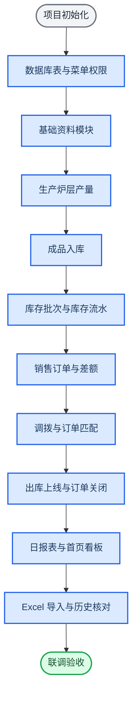
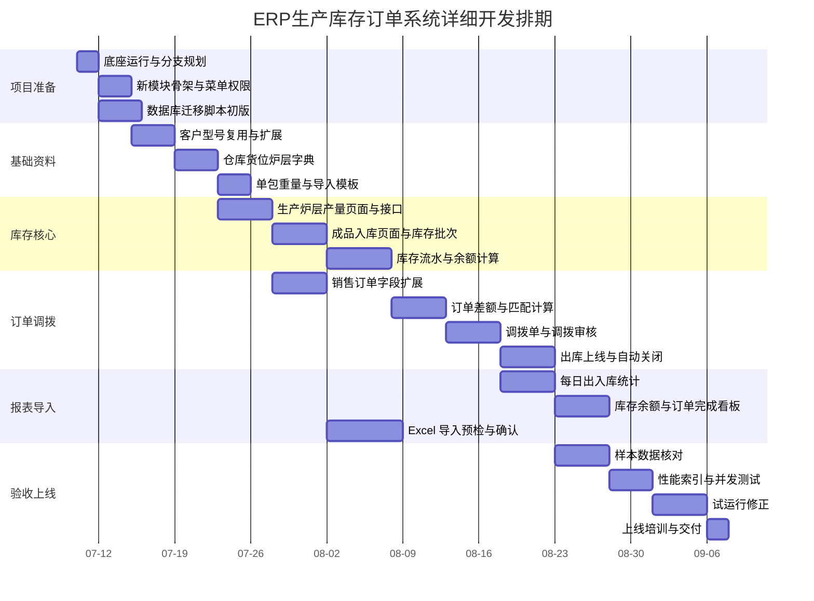

# ERP生产库存订单系统详细开发计划

_基于《ERP生产库存订单管理系统开发方案》的执行版计划，目标是按现有 ERP 后台页面风格开发生产后库存、订单差额、调拨、出库和日报表系统。_

---

## 目标

本计划用于指导后续正式开发，重点回答三个问题：

- 每个阶段具体开发什么
- 每个前端页面长什么样、有哪些字段和按钮
- 后端、数据库、接口、测试如何配合落地

页面必须仿照当前已登录 ERP 系统的管理后台风格：左侧深色菜单、顶部工具栏、页签导航、白色内容区、查询筛选表单、紧凑型表格、固定操作列、弹窗表单、统计卡片和图表看板。

> 关键约束：任何订单完成、出库、调拨、退货都不能删除历史数据，只能通过状态、流水和审计记录体现变化。

---

## 开发原则

### 技术原则

| 原则 | 要求 |
| --- | --- |
| 底座优先 | 使用 `ruoyi-vue-pro` 后端和 `yudao-ui-admin-vue3` 前端 |
| 独立业务模块 | 新增 `yudao-module-rd-inventory`，不直接污染通用 ERP 模块 |
| 页面复用 | 前端复用 `ContentWrap`、`el-form`、`el-table`、`Pagination`、`dict-tag`、权限按钮 |
| 流水追溯 | 库存变化必须先写流水，再更新余额 |
| 状态关闭 | 订单完成使用状态关闭，不物理删除 |
| 大数据友好 | 所有列表必须服务端分页，报表必须可走汇总表和异步导出 |

### 前端风格原则

| 页面元素 | 仿制要求 |
| --- | --- |
| 左侧菜单 | 深色侧边栏，一级菜单分组，二级菜单展开 |
| 顶部区域 | 保留顶部工具条、用户区、折叠菜单、页签 |
| 内容容器 | 使用白色 `ContentWrap`，页面不做营销式大卡片 |
| 搜索栏 | 第一块内容区为横向筛选表单，控件宽度统一约 `240px` |
| 操作按钮 | 搜索、重置、新增、导入、导出、删除、审核、关闭统一图标按钮 |
| 数据表格 | 条纹表格、超出省略、固定右侧操作列、服务端分页 |
| 表单弹窗 | 新增/编辑用弹窗或抽屉，详情可用抽屉 |
| 状态展示 | 使用标签颜色区分未完成、部分满足、已完成、已关闭、已作废 |
| 数字展示 | 数量右对齐，重量保留统一小数位，负数或不足差额高亮 |

---

## 总体执行路线

开发顺序必须从底层数据模型开始，再做核心业务闭环，最后做报表和视觉补齐。



---

## 里程碑

建议一期按 10 周开发，前 6 周完成核心闭环，第 7 到 8 周完成报表和导入，第 9 到 10 周做验算、性能和试运行。



---

## 后端开发计划

### 模块结构

后端新增模块建议路径：

```text
ruoyi-vue-pro/
└── yudao-module-rd-inventory/
    ├── pom.xml
    └── src/main/java/cn/iocoder/yudao/module/rd/
        ├── controller/admin/
        ├── service/
        ├── dal/dataobject/
        ├── dal/mysql/
        ├── enums/
        ├── convert/
        └── framework/
```

### 后端任务拆分

| 阶段 | 任务 | 产出 | 验收 |
| --- | --- | --- | --- |
| B-01 | 新增 `yudao-module-rd-inventory` Maven 模块 | 模块可被主工程识别 | `mvn compile` 通过 |
| B-02 | 建立数据库表迁移脚本 | `rd_*` 表和索引 | 本地 MySQL 可执行 |
| B-03 | 建立菜单、按钮、字典 SQL | 左侧菜单和权限点 | 管理后台可见菜单 |
| B-04 | 基础资料接口 | 客户、型号、货位、炉层 | 分页、新增、编辑、停用 |
| B-05 | 生产产出接口 | 炉号炉层产量 CRUD | 可按日期、客户、型号查询 |
| B-06 | 成品入库接口 | 生产产出转库存批次 | 生成入库流水和库存余额 |
| B-07 | 库存台账接口 | 库存批次分页、流水查询 | 余额与流水一致 |
| B-08 | 销售订单扩展接口 | 订单量、实际产额、差额 | 差额自动计算 |
| B-09 | 订单匹配服务 | 库存批次匹配订单 | 支持自产和调拨 |
| B-10 | 调拨服务 | 调出、调入、审核、作废 | 同事务写两边流水 |
| B-11 | 出库服务 | 出库上线、扣减库存 | 防止负库存 |
| B-12 | 订单关闭服务 | 满足后自动关闭 | 状态关闭不删数据 |
| B-13 | Excel 导入服务 | 预检、错误报告、确认导入 | 重复导入不重复记账 |
| B-14 | 报表接口 | 日统计、库存余额、订单完成 | 支持日期范围 |

### 核心服务边界

| Service | 职责 | 不能做的事 |
| --- | --- | --- |
| `RdProductionOutputService` | 管生产产出和炉层数量 | 不直接扣减库存 |
| `RdStockLotService` | 管库存批次余额 | 不绕过流水改数量 |
| `RdStockTransactionService` | 管库存流水 | 不做订单业务判断 |
| `RdSaleOrderService` | 管订单状态和差额 | 不直接写库存余额 |
| `RdOrderFulfillmentService` | 管订单和库存匹配 | 不生成出库单 |
| `RdTransferService` | 管调拨单审核执行 | 不允许单边调拨成功 |
| `RdReportService` | 管统计和看板 | 不直接改业务数据 |
| `RdImportService` | 管 Excel 导入 | 不跳过预检直接入账 |

---

## 数据库开发计划

### 第一批表

| 表 | 优先级 | 用途 |
| --- | --- | --- |
| `rd_location` | P0 | 货位主数据 |
| `rd_furnace_layer` | P0 | 炉层字典 |
| `rd_product_extend` | P0 | 型号扩展，维护单包重量 |
| `rd_production_output` | P0 | 生产炉层产量 |
| `rd_stock_lot` | P0 | 库存批次余额 |
| `rd_stock_transaction` | P0 | 库存流水 |
| `rd_sale_order_extend` | P0 | 销售订单扩展字段 |
| `rd_order_fulfillment` | P0 | 订单库存匹配 |
| `rd_transfer_order` | P1 | 调拨单主表 |
| `rd_transfer_order_item` | P1 | 调拨明细 |
| `rd_daily_stock_summary` | P1 | 日统计汇总 |
| `rd_excel_import_task` | P1 | Excel 导入任务 |
| `rd_excel_import_error` | P1 | 导入错误明细 |

### 字段落地顺序

| 顺序 | 字段组 | 说明 |
| --- | --- | --- |
| 1 | `客户`、`型号`、`货位` | 所有业务查询基础 |
| 2 | `生产炉号`、`所在炉层` | 库存批次核心维度 |
| 3 | `订单量`、`实际产额`、`差额` | 订单闭环核心 |
| 4 | `期初`、`入库`、`出库`、`退货`、`调拨` | 库存流水核心 |
| 5 | `库房数量`、`单包重量`、`库存重量` | 余额和报表核心 |
| 6 | `来源单号`、`来源行号`、`操作人` | 审计追溯 |

### 索引要求

| 表 | 索引 | 目的 |
| --- | --- | --- |
| `rd_stock_lot` | `customer_id, product_id, furnace_no, furnace_layer, location_id` | 库存台账主查询 |
| `rd_stock_transaction` | `biz_date, transaction_type` | 日统计 |
| `rd_stock_transaction` | `stock_lot_id, create_time` | 批次流水追溯 |
| `rd_sale_order_extend` | `order_id, status` | 订单状态 |
| `rd_order_fulfillment` | `order_item_id, stock_lot_id` | 匹配追溯 |
| `rd_transfer_order` | `transfer_no, status, transfer_date` | 调拨查询 |

---

## 前端开发计划

### 页面整体风格

所有新页面统一放在：

```text
yudao-ui-admin-vue3/
└── src/
    ├── views/rd/
    │   ├── home/
    │   ├── base/
    │   ├── production/
    │   ├── stock/
    │   ├── order/
    │   ├── transfer/
    │   ├── outbound/
    │   ├── report/
    │   └── import/
    └── api/rd/
```

所有列表页必须采用现有页面结构：

```vue
<template>
  <ContentWrap>
    <!-- 搜索工作栏 -->
    <el-form :inline="true" class="-mb-15px" label-width="68px">
      <!-- 查询条件 -->
      <!-- 搜索、重置、新增、导入、导出按钮 -->
    </el-form>
  </ContentWrap>

  <ContentWrap>
    <el-table :data="list" :stripe="true" :show-overflow-tooltip="true">
      <!-- 表格列 -->
      <!-- 固定右侧操作列 -->
    </el-table>
    <Pagination />
  </ContentWrap>
</template>
```

### 页面清单

| 菜单 | 页面 | 路径 | 参照页面 |
| --- | --- | --- | --- |
| 首页 | 瑞鼎库存看板 | `views/rd/home/index.vue` | `views/erp/home/index.vue`、当前 ERP 首页 |
| 基础资料 | 客户资料 | 复用/扩展 ERP 客户 | `views/erp/sale/customer/index.vue` |
| 基础资料 | 型号资料 | 复用/扩展 ERP 产品 | `views/erp/product/product/index.vue` |
| 基础资料 | 仓库货位 | `views/rd/base/location/index.vue` | `views/wms/md/warehouse/index.vue` |
| 基础资料 | 炉层字典 | `views/rd/base/furnace-layer/index.vue` | 通用字典页 |
| 生产管理 | 生产炉层产量 | `views/rd/production/output/index.vue` | ERP 订单列表结构 |
| 生产管理 | 成品入库 | `views/rd/stock/in/index.vue` | `views/erp/stock/in/index.vue` |
| 仓库管理 | 库存台账 | `views/rd/stock/lot/index.vue` | Excel 明细表 + ERP 库存列表 |
| 仓库管理 | 库存流水 | `views/rd/stock/transaction/index.vue` | `views/erp/stock/record/index.vue` |
| 订单管理 | 销售订单 | `views/rd/order/sale/index.vue` | `views/erp/sale/order/index.vue` |
| 订单管理 | 订单匹配 | `views/rd/order/fulfillment/index.vue` | 自定义左右表格 |
| 仓库管理 | 调拨单 | `views/rd/transfer/index.vue` | `views/erp/stock/move/index.vue` |
| 仓库管理 | 出库上线 | `views/rd/outbound/index.vue` | `views/erp/stock/out/index.vue` |
| 仓库管理 | 退货入库 | `views/rd/stock/return/index.vue` | `views/erp/sale/return/index.vue` |
| 报表中心 | 每日出入库统计 | `views/rd/report/daily/index.vue` | 当前 Excel 日期列统计 |
| 报表中心 | 订单完成情况 | `views/rd/report/order/index.vue` | ERP 报表表格 |
| 报表中心 | 库存余额 | `views/rd/report/balance/index.vue` | WMS 库存统计 |
| 数据导入 | Excel 导入 | `views/rd/import/excel/index.vue` | 导入任务列表 + 错误明细 |

### 页面布局规格

| 区域 | 规格 |
| --- | --- |
| 查询区 | 一行多条件，宽度 `240px`，超过自动换行 |
| 按钮区 | 放在查询区最后一个 `el-form-item` |
| 表格区 | 独立 `ContentWrap`，包含表格和分页 |
| 表格高度 | 默认随页面滚动，后期可加自适应高度 |
| 操作列 | 固定右侧，宽度 `180px` 到 `260px` |
| 弹窗 | `Form.vue` 文件单独维护，宽度按字段复杂度设置 |
| 详情 | 订单、库存批次、调拨单使用抽屉展示来源流水 |
| 导入 | 使用上传弹窗，先预检，再确认 |

---

## 重点页面设计

### 瑞鼎库存看板

页面目的：替代当前 ERP 首页的经营概览，用库存和订单指标做首页。

| 区域 | 内容 |
| --- | --- |
| 顶部卡片 | 今日入库、今日出库、今日调拨、待完成订单、库存总重量、库存批次数 |
| 趋势图 | 近 15 日入库/出库/调拨趋势 |
| 结构图 | 按客户库存重量、按型号库存重量 |
| 待办列表 | 待入库产出、待调拨订单、待出库订单 |
| 异常提醒 | 负库存风险、差额不足订单、导入失败任务 |

### 生产炉层产量页

| 类型 | 内容 |
| --- | --- |
| 筛选条件 | 日期范围、客户、型号、生产炉号、所在炉层、入库状态 |
| 表格字段 | 产出日期、客户、型号、生产炉号、所在炉层、实际产额、单包重量、预计重量、入库状态、创建人 |
| 操作按钮 | 新增、导入、导出、编辑、转入库、作废 |
| 表单字段 | 客户、型号、生产炉号、所在炉层、实际产额、单包重量、产出日期、备注 |
| 验收点 | 一条炉层产出只能转入库一次，作废后不能入库 |

### 成品入库页

| 类型 | 内容 |
| --- | --- |
| 筛选条件 | 入库日期、客户、型号、炉号、炉层、货位、来源状态 |
| 表格字段 | 入库单号、入库日期、货位、客户、型号、生产炉号、所在炉层、入库数量、单包重量、入库重量、状态 |
| 操作按钮 | 新增入库、从产出选择、审核、撤销、查看流水 |
| 表单字段 | 来源产出、货位、入库数量、单包重量、入库日期 |
| 验收点 | 审核后生成 `PRODUCTION_IN` 库存流水 |

### 库存台账页

该页面最接近现有 Excel 明细表，必须优先保证字段完整和查询效率。

| 类型 | 内容 |
| --- | --- |
| 筛选条件 | 货位、客户、型号、生产炉号、所在炉层、库存状态、日期 |
| 表格字段 | 货位、客户、型号、生产炉号、所在炉层、订单量、实际产额、差额、期初、调拨、入库、出库、退货、库房数量、单包重量、库存重量 |
| 操作按钮 | 新增期初、调整、调拨、出库、退货、查看流水、导出 |
| 行样式 | 库房数量为 0 灰色，差额不足红色，订单完成可删除线 |
| 验收点 | 列顺序必须与用户给出的 Excel 字段一致 |

### 销售订单页

| 类型 | 内容 |
| --- | --- |
| 筛选条件 | 订单号、客户、型号、订单状态、完成状态、日期 |
| 表格字段 | 订单号、客户、型号、订单量、实际产额、调入量、调出量、差额、调拨后差额、满足数量、状态 |
| 操作按钮 | 新增、编辑、匹配库存、调拨补足、出库上线、关闭、导出 |
| 表单字段 | 客户、型号、订单量、订单日期、备注 |
| 验收点 | 满足数量大于等于订单量后自动改为已完成 |

### 订单匹配页

页面目的：让用户清楚看到 A 单缺多少、可以从哪些库存批次补。

| 区域 | 内容 |
| --- | --- |
| 左侧订单 | 订单号、客户、型号、订单量、实际产额、差额 |
| 右侧库存批次 | 货位、客户、型号、炉号、炉层、可用数量、库存重量 |
| 底部已匹配 | 匹配批次、匹配数量、来源类型 |
| 操作 | 自动匹配、手动匹配、生成调拨、取消匹配 |
| 验收点 | 不允许匹配超过可用库存，不允许重复匹配同一数量 |

### 调拨单页

| 类型 | 内容 |
| --- | --- |
| 筛选条件 | 调拨单号、调拨日期、调出客户、调入订单、状态 |
| 表格字段 | 调拨单号、调拨日期、调出货位、调入订单、客户、型号、炉号、炉层、调拨数量、状态 |
| 操作按钮 | 新增、审核、撤销、查看流水、打印、导出 |
| 表单字段 | 调出库存批次、调入订单、调拨数量、原因 |
| 验收点 | 审核后生成 `TRANSFER_OUT` 和 `TRANSFER_IN` 两条流水 |

### 每日出入库统计页

| 类型 | 内容 |
| --- | --- |
| 筛选条件 | 日期范围、客户、型号、货位、炉号、炉层 |
| 表格字段 | 日期、客户、型号、入库、出库、调入、调出、退货、净变化、库存重量 |
| 图表 | 入库/出库/调拨折线图 |
| 操作 | 查询、重置、导出 |
| 验收点 | 与库存流水按日期汇总一致 |

---

## API 开发计划

### 接口分组

| 分组 | 路径前缀 | 说明 |
| --- | --- | --- |
| 基础资料 | `/admin-api/rd/base` | 货位、炉层、型号扩展 |
| 生产产出 | `/admin-api/rd/production-output` | 炉层产量 |
| 成品入库 | `/admin-api/rd/stock-in` | 入库单 |
| 库存台账 | `/admin-api/rd/stock-lot` | 批次余额 |
| 库存流水 | `/admin-api/rd/stock-transaction` | 出入库明细 |
| 销售订单 | `/admin-api/rd/sale-order` | 订单扩展 |
| 订单匹配 | `/admin-api/rd/order-fulfillment` | 匹配和差额 |
| 调拨单 | `/admin-api/rd/transfer` | 调拨业务 |
| 出库上线 | `/admin-api/rd/outbound` | 出库业务 |
| 报表 | `/admin-api/rd/report` | 日报、余额、完成情况 |
| Excel 导入 | `/admin-api/rd/import` | 导入预检和确认 |

### 接口交付顺序

| 顺序 | 接口能力 | 前端页面依赖 |
| --- | --- | --- |
| 1 | 基础资料分页和简单列表 | 所有下拉框 |
| 2 | 生产产出 CRUD | 生产炉层产量页 |
| 3 | 产出转入库 | 成品入库页 |
| 4 | 库存批次分页 | 库存台账页 |
| 5 | 库存流水分页 | 库存流水页和详情抽屉 |
| 6 | 销售订单分页和扩展字段 | 销售订单页 |
| 7 | 差额重算 | 订单列表和看板 |
| 8 | 调拨执行 | 调拨单页 |
| 9 | 出库执行 | 出库上线页 |
| 10 | 报表汇总 | 首页和报表中心 |
| 11 | Excel 导入 | 导入页面 |

---

## 测试计划

### 单元测试

| 服务 | 测试重点 |
| --- | --- |
| 库存计算 | 入库、出库、退货、调拨后余额正确 |
| 差额计算 | `订单量 - 实际产额` 和调拨后差额正确 |
| 订单关闭 | 满足数量达到订单量后状态关闭 |
| 调拨事务 | 调出失败时调入不能成功 |
| 导入幂等 | 同一文件重复导入不重复增加库存 |

### 业务验算

| 场景 | 数据 | 预期 |
| --- | --- | --- |
| 生产入库 | 1 个炉号 3 个炉层 | 生成 3 个库存批次 |
| 订单不足 | 订单量 100，实际产额 80 | 差额 20 |
| B 调拨给 A | A 缺 20，B 调拨 20 | A 订单完成，B 库存减少 |
| 出库上线 | A 出库 100 | A 库存减少，出库日统计增加 |
| 退货入库 | 退货 5 | 库存增加，退货日统计增加 |
| Excel 核对 | 抽样 20 行 | 库房数量和库存重量一致 |

### 前端验收

| 项 | 标准 |
| --- | --- |
| 页面风格 | 与当前 ERP 后台一致，不能做成营销页或大屏页 |
| 查询 | 所有列表支持服务端分页和组合筛选 |
| 操作 | 新增、编辑、导入、导出、审核、关闭均有权限控制 |
| 表格 | 列顺序和字段名贴近 Excel，右侧操作固定 |
| 弹窗 | 表单字段完整，必填校验清晰 |
| 反馈 | 成功、失败、二次确认、加载状态齐全 |
| 响应式 | 窄屏不遮挡按钮，表格允许横向滚动 |

---

## 每周开发清单

### 第 1 周：底座和数据模型

| 角色 | 任务 |
| --- | --- |
| 后端 | 新建模块、配置依赖、建立数据库表、菜单权限 SQL |
| 前端 | 新建 `src/views/rd` 和 `src/api/rd` 目录，创建菜单占位页 |
| 测试 | 准备 Excel 样本和业务验算表 |
| 交付 | 能看到菜单，后端模块可编译，数据库表可创建 |

### 第 2 周：基础资料

| 角色 | 任务 |
| --- | --- |
| 后端 | 货位、炉层、型号扩展、单包重量接口 |
| 前端 | 仓库货位、炉层字典、型号扩展页面 |
| 测试 | 验证新增、编辑、停用、下拉选择 |
| 交付 | 基础资料可维护，业务页面下拉可用 |

### 第 3 周：生产炉层产量

| 角色 | 任务 |
| --- | --- |
| 后端 | 生产产出 CRUD、导入预检初版 |
| 前端 | 生产炉层产量列表、表单、导入按钮 |
| 测试 | 验证炉号、炉层、客户、型号组合 |
| 交付 | 生产产出可录入，可查询，可导入样本 |

### 第 4 周：成品入库和库存批次

| 角色 | 任务 |
| --- | --- |
| 后端 | 产出转入库、库存批次余额、入库流水 |
| 前端 | 成品入库列表、入库表单、库存台账初版 |
| 测试 | 验证入库后库存数量和重量 |
| 交付 | 一条生产产出可形成库存批次 |

### 第 5 周：库存台账和库存流水

| 角色 | 任务 |
| --- | --- |
| 后端 | 库存台账分页、库存流水分页、期初和调整 |
| 前端 | 库存台账完整字段、流水详情抽屉、调整弹窗 |
| 测试 | 验证期初、入库、出库、退货、调拨公式 |
| 交付 | Excel 主表字段在系统中完整出现 |

### 第 6 周：销售订单和差额

| 角色 | 任务 |
| --- | --- |
| 后端 | 销售订单扩展、实际产额汇总、差额重算 |
| 前端 | 销售订单列表、订单差额列、订单详情 |
| 测试 | 验证订单量、实际产额、差额计算 |
| 交付 | 订单不足、部分满足、已满足状态可见 |

### 第 7 周：订单匹配和调拨

| 角色 | 任务 |
| --- | --- |
| 后端 | 订单匹配、调拨单、审核执行、撤销 |
| 前端 | 订单匹配页面、调拨单页面、调拨弹窗 |
| 测试 | 验证 A 缺货从 B 调拨补足 |
| 交付 | 调拨后订单可自动变为满足 |

### 第 8 周：出库上线和日报表

| 角色 | 任务 |
| --- | --- |
| 后端 | 出库上线、订单自动关闭、日汇总任务 |
| 前端 | 出库上线页、每日出入库统计页 |
| 测试 | 验证出库扣库存、订单关闭、日统计 |
| 交付 | 入库、调拨、出库、关闭完整闭环 |

### 第 9 周：Excel 导入和看板

> 状态：已于 2026-07-10 完成。验收证据见《第 9 周开发验收记录》；下一阶段进入第 10 周性能、权限和试运行。

| 角色 | 任务 |
| --- | --- |
| 后端 | Excel 导入确认、错误报告、首页统计接口 |
| 前端 | 导入任务页、错误明细、瑞鼎库存看板 |
| 测试 | 用真实 Excel 样本核对 20 到 50 行 |
| 交付 | 可迁移历史表格，可看首页统计 |

### 第 10 周：性能、权限和试运行

> 状态：性能与并发、岗位权限、操作审计和异常提示已于 2026-07-10 完成；下一步进入备份恢复、部署演练、培训说明和试运行版本交付。

| 角色 | 任务 |
| --- | --- |
| 后端 | 索引优化、并发锁、操作日志、备份脚本 |
| 前端 | 权限按钮、异常提示、页面细节统一 |
| 测试 | 压测列表、并发出库、权限回归 |
| 交付 | 试运行版本、部署文档、培训说明 |

---

## 页面还原验收清单

前端开发完成后，必须按下面清单检查，确保“和那个 ERP 页面一样”。

| 项目 | 验收标准 |
| --- | --- |
| 菜单 | 左侧深色菜单，图标、层级、展开方式与现有后台一致 |
| 顶栏 | 保留折叠、面包屑或页签、用户菜单 |
| 查询区 | 白色容器、横向表单、统一控件宽度、按钮带图标 |
| 表格 | 白色容器、条纹行、超出提示、分页在底部 |
| 操作列 | 固定右侧，按钮文字短，危险操作二次确认 |
| 弹窗 | 标题、底部按钮、表单校验风格一致 |
| 状态标签 | 使用 `dict-tag` 或同风格标签，不手写杂色块 |
| 看板卡片 | 与 ERP 首页统计卡片类似，不做夸张装饰 |
| 图表 | 使用 ECharts 朴素折线/柱状图，与首页统计风格一致 |
| 字体间距 | 紧凑、工作台风格，避免大标题和营销文案 |

---

## 立即开始的任务

正式进入开发时，建议第一天按此顺序执行：

1. 确认 `ruoyi-vue-pro` 后端能在本机编译
2. 确认 `yudao-ui-admin-vue3` 前端能安装依赖并启动
3. 在后端创建 `yudao-module-rd-inventory`
4. 在前端创建 `src/views/rd` 和 `src/api/rd`
5. 建立第一版数据库表：货位、炉层、生产产出、库存批次、库存流水
6. 建立菜单：瑞鼎库存、生产管理、仓库管理、订单管理、报表中心
7. 先做 `生产炉层产量` 和 `库存台账` 两个页面骨架
8. 用 5 到 10 行 Excel 样本做第一轮端到端验证

---

## 交付物清单

| 类别 | 交付物 |
| --- | --- |
| 代码 | 后端模块、前端页面、SQL 迁移脚本 |
| 文档 | 部署文档、操作手册、数据字典、接口说明 |
| 数据 | Excel 导入模板、样本核对表、导入错误报告 |
| 测试 | 单元测试、接口测试、业务验算记录、性能测试记录 |
| 上线 | 试运行版本、备份方案、回滚方案、培训材料 |

---

## 关键确认项

下面问题需要在第 1 周内确认，否则会影响表结构和公式：

- `订单量` 按包数、重量，还是两者都需要
- `实际产额` 与 `入库数量` 是否一定相等
- `货位` 是否允许一个批次拆分到多个货位
- `调拨` 是否允许跨客户、跨型号、跨炉号
- 订单完成是否必须同时出库，还是满足数量后即可关闭
- 退货是否回到原订单、原炉号炉层，还是作为新库存批次
- Excel 历史数据要导入多久范围
- 是否需要打印入库单、调拨单、出库单

确认后即可进入正式编码。
