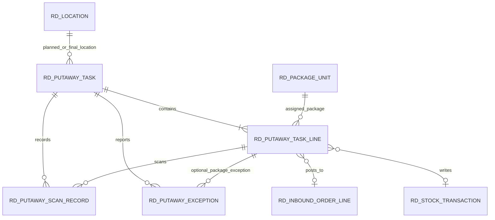

# 入库上架数据结构设计

> 对应总计划：B2
>
> 版本：1.0
>
> 制定日期：2026-09-21
>
> 适用范围：库位地图、上架任务、任务包明细、PDA 扫码、现场异常及最终库存过账的数据库基础。

## 1. 设计结论

1. 延续现有 MySQL、MyBatis Plus、租户字段、软删除和审计字段规范，不引入第二套数据库。
2. `rd_location` 是库位主数据，记录仓库、区域、排、列、层、包数/重量容量、实际占用、任务预留和运行状态。
3. `rd_putaway_task` 是一次上架作业主单，一个任务在同一时刻只有一个计划库位和一名叉车司机。
4. `rd_putaway_task_line` 按 PCS 保存客户、型号、炉号、炉层和重量快照，批扫不会合并或覆盖单包属性。
5. `rd_putaway_scan_record` 每扫一次记录一次，成功、重复、错包和状态错误都留痕；幂等键防止网络重试重复计数。
6. `rd_putaway_exception` 保存司机上报原因、照片引用、备注、处理人、处理结果和仓管调整后的计划库位。
7. 司机端只写扫码记录和异常记录，不能写 `final_location_id`；最终库位、正式占用和库存流水只能由仓管确认上架事务写入。

## 2. 数据关系

数据库沿用现有项目不设置物理外键的做法，避免历史数据、软删除和批量导入被外键阻塞；关联完整性由事务锁、状态校验、唯一约束和业务测试共同保证。

## 3. 库位主数据扩展

| 字段组 | 主要字段 | 用途 |
| --- | --- | --- |
| 空间坐标 | `warehouse_code`、`area_code`、`row_code`、`column_code`、`level_code` | 支撑仓库/区域/排/列/层地图 |
| 容量 | `capacity_packages`、`capacity_weight` | 同时控制包数和重量，兼容 600 kg、1000 kg 等不同包重 |
| 实际占用 | `occupied_packages`、`occupied_weight` | 已由正式入库事务过账的占用 |
| 任务预留 | `reserved_packages`、`reserved_weight` | 已派单但尚未最终确认的容量预留 |
| 运行状态 | `enabled`、`frozen`、`location_status` | 区分停用、盘点冻结、限制使用和维护状态 |
| 并发 | `version` | 仓管同时派单或确认时做乐观锁校验 |

库位可用量按以下口径计算：

- 可用包数 = 包数容量 - 实际占用包数 - 任务预留包数；
- 可用重量 = 重量容量 - 实际占用重量 - 任务预留重量；
- 任一设置了上限的维度不足时，都不能继续派单或确认上架；
- `FULL`、`PARTIAL`、`EMPTY` 是页面根据容量和占用实时计算的展示状态，不另存一份容易过期的数据。

## 4. 上架任务主单

| 字段组 | 主要字段 | 约束或说明 |
| --- | --- | --- |
| 标识 | `task_no` | 租户内唯一 |
| 状态 | `status` | 使用 B1 七态状态机 |
| 计划库位 | `planned_location_id/code` | 仓管派单或改派时写入 |
| 最终库位 | `final_location_id/code` | 仅仓管确认上架时写入 |
| 进度 | `package_count`、`scanned_package_count`、`exception_package_count`、`total_weight` | PDA 和 Web 共用的任务统计 |
| 责任人 | `warehouse_keeper_id/name`、`forklift_driver_id/name` | 明确派单与执行责任 |
| 时间 | `assigned_time`、`start_time`、`scan_complete_time`、`confirm_time`、`cancel_time` | 支撑追溯和时效统计 |
| 并发 | `version` | 旧页面提交不能覆盖新状态 |

常用索引覆盖状态待办、司机待办、仓管待办和计划库位占用查询。

## 5. 任务包明细

每个明细绑定一个 `package_id/package_code`，同时保存客户、型号、炉号、炉层和包重快照。明细状态独立记录 `PENDING`、`SCANNED`、`EXCEPTION`、`CONFIRMED` 或 `CANCELLED`，扫码次数和首末扫码时间用于处理重复扫描及断网重试。

任务完成后，明细回填 `inbound_order_id`、`inbound_order_line_id`、`stock_lot_id` 和 `stock_transaction_id`，从一个 PCS 可以追到正式入库单、库存批次和库存流水。一个任务内同一包只能出现一次，同一行号也只能出现一次。

## 6. 扫码记录

| 字段组 | 主要字段 | 说明 |
| --- | --- | --- |
| 业务定位 | `task_id`、`task_line_id`、`package_id/code` | 可记录任务内正确包，也可保留错扫包码 |
| 幂等 | `idempotency_key` | “租户 + 任务 + 幂等键”唯一 |
| 结果 | `scan_result`、`success`、`error_code/message` | 成功和失败都留痕 |
| 状态快照 | `task_status_before/after` | 便于还原首包自动开始等状态变化 |
| 现场信息 | `device_code`、`operator_id/name`、`device_time`、`scan_time` | 同时保留设备时间和服务端时间 |

客户端网络超时后必须复用同一个幂等键重试。重复请求返回原结果，不新增第二条成功记录，也不重复增加已扫包数。

## 7. 异常记录

异常记录支持任务级和单包级两种情况。库位放不下、库位被占属于任务级；错包、标签损坏、货物缺失可关联具体明细。`description` 必填，照片或附件保存为内部文件服务引用，不在业务表中存二进制文件。

仓管处理时填写处理人、处理时间、处理结果和处置动作；如改派库位，同时记录原计划库位与新计划库位。异常记录不直接修改 PCS 最终库位，任务改派和最终确认仍走对应状态动作。

## 8. 事务与一致性边界

1. 派单事务锁定包和库位，创建任务及明细，把包状态改为 `INBOUND_PENDING`，并增加库位预留。
2. 扫码事务锁定任务和明细，插入扫码记录并更新计数；重复幂等键不重复处理。
3. 异常事务插入异常记录，把任务转为 `EXCEPTION_PENDING`，保留已扫进度。
4. 仓管改派事务在同一事务内释放原库位预留、增加新库位预留并更新任务版本。
5. 确认上架事务锁定任务、全部包和库位，重新计算容量后一次性更新 PCS、正式占用、入库单、库存批次和库存流水，并释放预留。
6. 任一步失败都整体回滚，不能出现“任务完成但库存没入账”或“库存入账但库位没占用”。

## 9. 初始化与升级

- 新数据库：执行 `backend/sql/mysql/rd_erp_clean.sql`，直接得到完整 B2 结构。
- 现有数据库：备份并恢复到隔离库后，执行 `backend/sql/mysql/rd_erp_upgrade_slim.sql`。
- 自动验证：执行 `scripts/verification/Verify-RdPutawaySchema.ps1`，脚本会创建临时数据库，验证空库初始化、模拟旧结构升级及升级脚本连续执行两次。
- 验证脚本只管理名称以 `rd_erp_b2_clean_test_` 或 `rd_erp_b2_upgrade_test_` 开头的临时数据库，不改动开发业务库。

## 10. 后续实现边界

B2 只完成数据库结构、Java 数据对象、Mapper 和可重复升级验证。B3 开发仓管 Web 库位地图与派单；B4 开发司机 PDA 待办；B5 落地扫码、异常、改派和最终上架事务；B6 补齐权限、状态审计、并发及异常恢复测试。
