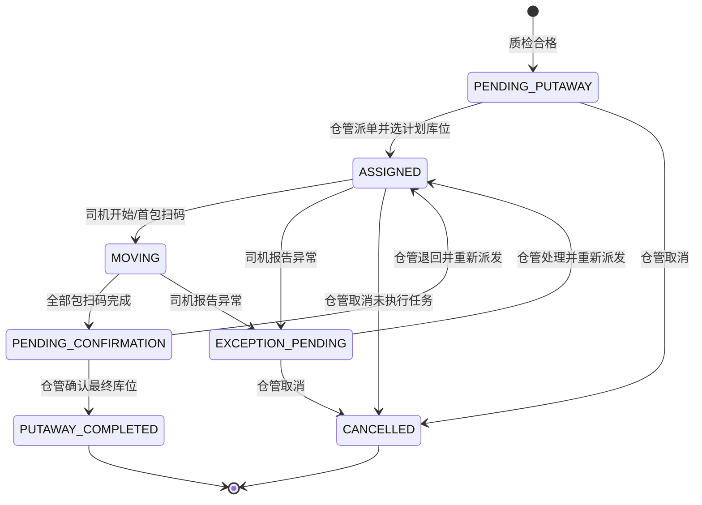

# 入库上架状态机与角色权限规格

> 对应总计划：B1
>
> 版本：1.0
>
> 制定日期：2026-09-21
>
> 适用范围：质检合格成品包从待上架货物池到正式库存的物理搬运、库位确认和库存过账。

## 1. 已确认的现场原则

1. 质检合格后，货物先进入“待上架”，不能直接成为正式在库库存。
2. 仓管员查看库位地图，选择计划库位并把任务派给叉车司机。
3. 叉车司机负责执行搬运、连续扫包和反馈现场异常，不负责更新最终库位。
4. 计划库位放不下、被占或实物不符时，司机提交异常；仓管员调整后重新同步任务。
5. 全部包扫码完成后进入“待仓管确认”，只有仓管员确认最终库位才能正式入库。
6. 仓管员最终确认是一期唯一的人工库存过账动作，系统在同一事务内更新 PCS、库存台账、库位占用和库存流水，避免额外增加“提交、复核、过账”三次点击。
7. 一个任务可连续批扫多包；型号、炉号、炉层等属性仍按每个 PCS 保存，不因批扫合并或丢失。

## 2. 当前实现与目标差距

| 项目 | 当前实现 | B1 目标 | 后续落点 |
| --- | --- | --- | --- |
| 质检合格后 | 包状态为 `QC_PASSED`，在创建入库单时人工选择 | 自动进入待上架货物池 | B2 数据查询与任务表 |
| 库位选择 | 创建入库单时直接给每包写 `location_id/location_code` | 仓管员只选择计划库位，最终库位未确认前不写正式库存 | B2、B3 |
| 司机任务 | 无独立任务和司机字段 | 指定司机、PDA 待办、连续扫码、进度统计 | B2、B4 |
| 异常处理 | 无库位放不下/被占等业务异常 | 司机提交异常，仓管员处理并重新派发 | B2、B5 |
| 正式入库 | 入库单 `VERIFIED -> POSTED` 时直接过账 | 仓管员最终确认上架时原子过账 | B5 |
| 状态表达 | 入库单只有草稿、提交、复核、过账、撤销 | 单独增加七态上架任务状态机 | B1、B2 |
| 库位占用 | 仅从库存批次间接判断 | 区分实际占用、上架预留和可用容量 | B2、B3 |
| 权限边界 | 库房权限集中在入库单操作 | 仓管派单/确认与司机执行/异常严格分离 | B3-B6 |

现有 `rd_inbound_order` 和历史数据继续保留。新上架任务是物理作业主线；一期迁移后，正式入库单和库存流水在仓管确认上架时生成或过账，不重写已有历史单据。

## 3. 状态定义

| 中文状态 | 代码值 | 进入条件 | 允许的下一动作 | 责任岗位 |
| --- | --- | --- | --- | --- |
| 待上架 | `PENDING_PUTAWAY` | 质检合格且未进入其他有效上架任务 | 派单、取消 | 仓管员 |
| 已派单 | `ASSIGNED` | 仓管选择计划库位和司机，任务已同步 | 仓管调整派单、司机开始、司机报异常、仓管取消 | 仓管员/司机 |
| 搬运中 | `MOVING` | 司机开始任务或首包扫码成功 | 完成扫码、司机报异常 | 叉车司机 |
| 待仓管确认 | `PENDING_CONFIRMATION` | 任务内应扫包全部校验成功 | 确认上架、退回司机 | 仓管员 |
| 已上架 | `PUTAWAY_COMPLETED` | 仓管确认最终库位且库存事务成功 | 无 | 仓管员/系统 |
| 异常待处理 | `EXCEPTION_PENDING` | 司机提交库位或货物异常 | 仓管重新派发、仓管取消 | 仓管员 |
| 已取消 | `CANCELLED` | 仓管取消未完成任务并释放预留 | 无 | 仓管员/系统 |

`PUTAWAY_COMPLETED` 和 `CANCELLED` 是终态，不能再继续执行扫码或改派。已上架后的库位变化必须走独立移库/调拨流程，不能回改上架任务。

## 4. 状态图

## 5. 状态转换与前置条件

| 动作 | 发起岗位 | 原状态 | 目标状态 | 必须满足 | 事务结果 |
| --- | --- | --- | --- | --- | --- |
| `ASSIGN` 派单 | 仓管员 | 待上架 | 已派单 | 包均质检合格、未被有效任务占用；库位启用且未冻结；司机有效 | 保存计划库位、司机、任务明细并预留容量 |
| `ADJUST_ASSIGNMENT` 调整派单 | 仓管员 | 已派单 | 已派单 | 司机尚未开始执行；仓管重新确定计划库位或司机并说明原因 | 释放原预留、占用新预留、更新司机并重新同步 PDA，状态不变但完整留痕 |
| `START` 开始 | 叉车司机 | 已派单 | 搬运中 | 当前登录司机是任务执行人；任务未撤回 | 记录开始人和开始时间 |
| `COMPLETE_SCANNING` 完成扫码 | 叉车司机 | 搬运中 | 待仓管确认 | 任务内全部有效包已成功扫码，无未处理异常 | 固化已扫包数和完成时间，不写最终库位 |
| `REPORT_EXCEPTION` 报异常 | 叉车司机 | 已派单/搬运中 | 异常待处理 | 原因、备注必填；照片按现场设备能力选填 | 冻结任务执行，通知仓管，保留扫码进度 |
| `REASSIGN` 重新派发 | 仓管员 | 异常待处理 | 已派单 | 仓管已确定处理结果、计划库位和司机 | 关闭异常处理，更新计划并重新同步 PDA |
| `RETURN_TO_DRIVER` 退回 | 仓管员 | 待仓管确认 | 已派单 | 说明退回原因；必要时调整计划库位 | 保留历史扫码，要求按服务端规则补扫或重扫 |
| `CONFIRM_PUTAWAY` 确认上架 | 仓管员 | 待仓管确认 | 已上架 | 最终库位由仓管确认；包数/重量一致；库位未冻结且容量可用 | 原子更新 PCS、库存批次、库位占用、入库单和库存流水 |
| `CANCEL` 取消 | 仓管员 | 待上架/已派单/异常待处理 | 已取消 | 不存在已正式过账库存；已扫实物已核回 | 释放任务和库位预留，包回到可再次派单状态 |

所有写操作必须携带版本号或等价并发控制。状态已变化时，旧 PDA 页面提交必须失败并刷新最新任务，不能静默覆盖。

## 6. 角色权限矩阵

| 能力 | 质检 | 仓管员 | 叉车司机 | 系统 |
| --- | --- | --- | --- | --- |
| 质检放行并形成待上架候选 | 执行质检审批 | 查看 | 查看本人任务关联结果 | 生成候选关系 |
| 查看全部待上架货物池 | 否 | 是 | 否 | 提供查询 |
| 查看库位地图与容量 | 只读可选 | 是 | 仅看任务目标库位 | 汇总实际占用和预留 |
| 创建/派发/改派任务 | 否 | 是 | 否 | 校验并记录 |
| 开始任务、连续扫码 | 否 | 只读进度 | 是，仅本人任务 | 逐包校验、幂等记账 |
| 提交现场异常 | 否 | 可代录管理异常 | 是，仅本人任务 | 留痕并通知 |
| 修改计划库位 | 否 | 是 | 否 | 记录变更前后值 |
| 确认最终库位 | 否 | 是 | 否 | 校验后原子过账 |
| 直接修改 PCS 当前库位 | 否 | 否 | 否 | 只允许由正式业务事务写入 |
| 取消任务 | 否 | 是 | 否 | 释放预留并留审计 |

### 司机端硬限制

- 不提供库位选择控件，不接受司机端传入的最终库位字段。
- 扫码接口只接受任务号、包码、请求幂等键和设备时间；服务端从任务读取计划库位。
- 异常接口只接受任务号、异常类型、备注和附件引用，不直接修改计划或最终库位。
- 司机所有动作最多到达“待仓管确认”，任何司机动作都不能进入“已上架”。

## 7. 包状态与任务状态映射

| 上架任务阶段 | 包状态建议 | 正式当前库位 | 库存台账 |
| --- | --- | --- | --- |
| 未建任务/待上架 | `QC_PASSED` | 空 | 不增加 |
| 已派单至待仓管确认 | `INBOUND_PENDING` | 空；计划库位只存在任务明细 | 不增加，库位计入预留 |
| 异常待处理 | `INBOUND_PENDING` | 空 | 不增加，按任务保留或释放预留 |
| 已上架 | `IN_STOCK` | 写入仓管确认的最终库位 | 增加并写库存流水 |
| 已取消 | `QC_PASSED` | 空 | 不增加并释放预留 |

一期继续复用现有包状态，不用包状态承担“已派单、搬运中、异常”等任务级细分，避免一个包字段表达两套流程。

## 8. 批扫、库位容量和并发规则

1. 一个上架任务对应一个当前计划库位，可包含多个 PCS；司机进入任务后连续扫包，不重复选择库位。
2. 不同炉号、炉层可以出现在同一任务中，但每包属性独立保存并逐包校验，页面必须显示包码和关键识别信息。
3. 库位地图的可用容量按“容量 - 已上架实际占用 - 有效任务预留”计算，防止两个仓管员同时把同一空位派满。
4. 首包成功扫码可自动触发 `START`，减少司机点击；重复扫码只返回“已扫”，不得重复计数。
5. 扫码唯一键建议采用“租户 + 上架任务 + 包码”，请求另带客户端幂等键，网络重试不得生成两条成功记录。
6. 仓管确认时必须重新锁定任务、包和库位并复算容量；派单时容量足够不代表最终确认时仍然足够。
7. 上架成功事务失败时，任务保持待仓管确认，PCS、库存和库位占用全部回滚，不允许部分包入账。

## 9. 异常分类

| 异常代码 | 中文名称 | 司机可提交 | 仓管处理方向 |
| --- | --- | --- | --- |
| `LOCATION_CAPACITY_INSUFFICIENT` | 库位放不下 | 是 | 选择新计划库位后重新派发 |
| `LOCATION_OCCUPIED` | 库位被占 | 是 | 核对地图，清理差异或改派 |
| `PACKAGE_MISMATCH` | 货物不属于任务 | 是 | 核对包码与生产/质检来源 |
| `LABEL_DAMAGED` | 标签损坏 | 是 | 核对身份并走补打留痕 |
| `PACKAGE_MISSING` | 任务货物找不到 | 是 | 盘点、移除明细或取消任务 |
| `OTHER` | 其他 | 是 | 备注必填，仓管给出处置结果 |

## 10. 审计与验收证据

每次状态变化至少记录租户、任务号、原状态、目标状态、动作、操作人 ID/姓名、岗位、时间、设备或终端、备注和请求幂等键。计划库位、司机、任务明细发生变更时必须记录变更前后值。

B3-B6 验收时使用《入库上架闭环验收记录模板》，至少保留：

- 一张真实或经批准的模拟质检合格单；
- 一张上架任务及其全部包码；
- 一组连续扫码成功/重复/错码记录；
- 一次司机报异常、仓管改派和重新同步记录；
- 一次仓管最终确认后的 PCS、库存、库位占用和流水一致性核对；
- 一次并发或网络重试幂等验证。

## 11. B2 实现边界

B2 在本规格基础上新增上架任务、任务明细、扫码记录和异常记录表，并补齐库位预留/实际占用查询。B2 不提前开发 Web 派单页面或 PDA 页面；这些分别由 B3、B4 完成。任何字段调整都不得改变“司机不改最终库位、仓管确认后才过账”的责任边界。
