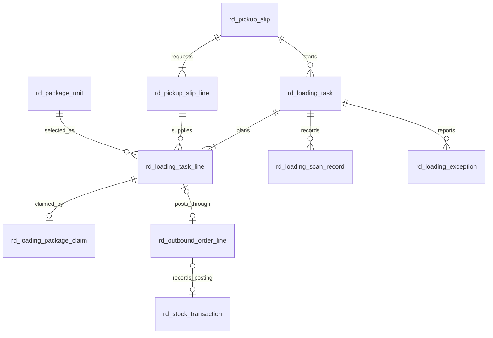

# 出库装车数据结构设计（C2）

版本：2026-09-22。承接《出库装车状态机与角色权限规格》。本阶段只建立数据结构、Java 映射和数据库约束；业务写入、派单页面、司机扫码、异常处理及新任务关联出库过账仍在 C3-C6 实施。所有数量/重量测试使用临时数据，不代表工厂实际提货单。

## 1. 业务对象与关系

正常情况下，一张有效提货单对应一张主装车任务；不因多个库位、型号、炉号、炉层或订单履约批次拆成多个司机操作任务。数据库保留提货单到任务的一对多索引，允许后续对撤回重建、分车次等经业务确认的情形处理历史，但 C3 默认只允许一个非终态主任务。任务明细逐包保存差异；同一任务可关联多个现有出库单。一个 `rd_outbound_order` 仍只对应其现有履约批次/库存批次，不能为了界面方便改变它的业务含义。

## 2. 提货单：商务来源，不在生产端重复填

- `rd_pickup_slip` 保存原提货单号、客户、提货日期、车辆、运输司机及联系方式、计划包数/重量、附件引用、签发人和版本。运输司机与厂内叉车司机是不同字段，不混用。
- `rd_pickup_slip_line` 保存原单明细、可选销售订单、品名/型号、可选炉号/炉层及请求包数/重量。原单只有吨数时包数可空；没有炉层要求时炉层可空。不能把空值擅自解释为任意客户或任意型号。
- 重量统一以 kg 存储（`decimal(24,6)`）；前端需要吨数时由显示层换算。C3 录入必须核对至少一种有效数量口径，并核对客户与关联销售订单；原单图片或文件只存受控引用，不把二进制塞入二维码或数据库列。
- 提货单状态初始为 `ISSUED`；撤回、修订的具体接口及已派任务联动在 C3/C5 实现。即使原单撤回，也不能直接覆盖已有扫码和任务历史。

## 3. 装车任务与逐包计划

- `rd_loading_task` 保存任务号、提货单引用和单号快照、客户、车辆及运输司机快照、仓管员、厂内叉车司机、实际复核人、七态状态、计划/已扫包数和重量、计划版本与并发版本，以及派单、开始、扫码完成、确认和取消时间。
- `rd_loading_task_line` 每条只指向一个具体 PCS；记录提货单明细、包码、销售订单/履约批次、库存批次、计划库位、客户、型号、炉号、炉层和包净重。`outbound_order_id`、`outbound_order_line_id`、`stock_transaction_id` 初始可空，C5 生成与过账成功时填入，便于从包反查出库单和流水。
- 派单时 PCS 必须已在库且归属客户和销售订单/履约条件匹配。任务明细的型号、炉层、位置等是派单时快照；扫码和过账时必须重新读取当前 PCS、库位状态与库存，而不是相信快照仍然有效。
- 计划版本 `plan_version` 每次仓管换包、改库位或改派司机时递增；扫描和异常记录带当时版本，历史记录不能被覆盖。任务明细状态建议 `PLANNED -> SCANNED -> OUTBOUNDED`，被换下的行标记 `REPLACED` 或 `CANCELLED` 并保留历史。重新加入同一包时复用/恢复原行并重新核对，不靠软删除制造重复有效明细。
- `tenant_id + task_no` 唯一；任务内行号和包 ID 分别唯一。跨表同租户、客户、来源单、包归属的完整性由 C3/C5 服务事务校验，单靠索引不够。

## 4. 有效包占用与并发

`rd_loading_package_claim` 是**当前有效占用**，`tenant_id + package_id` 唯一，另以 `tenant_id + task_line_id` 唯一。仓管派单的同一数据库事务先锁定包、校验 `IN_STOCK`、写任务明细并插入占用；唯一键冲突时整个派单回滚，提示该包已被其他任务选中。不能只先查再插，因为两个仓管可能同时看到“未占用”。

仓管换包或取消任务时，在实物/已扫状态核对后事务性地删除旧占用并处理相应任务行；成功过账后，PCS 变 `OUTBOUNDED` 且占用释放，未来仍由包状态阻止再次出库。占用表采用硬删除，因为它只表达当前互斥关系；永久审计保留在任务行、扫描、异常和操作日志中。不得只删占用而留下有效任务行。C6 应增加孤儿占用巡检和并发测试。

## 5. 扫码与异常记录

- `rd_loading_scan_record` 每次尝试保存任务、可解析时的任务行/包、包码、计划版本、设备、操作人、设备时间、服务端扫码时间、结果、错误及状态前后值。`tenant_id + task_id + idempotency_key` 唯一，用于网络重试去重；同一包不同请求的重复扫码仍可留痕，但不得重复增加已扫数量。
- `rd_loading_exception` 保存任务/包、异常类型、说明、可选附件、司机报告位置、报告人和时间、仓管处理人/处理结果、仓管核定后的库位及计划版本。司机报告的位置不直接写入 PCS 最终库位；只有仓管处理后才可改计划或实际库位。
- 扫描记录和异常记录原则上只追加/变更处理状态，不提供业务删除入口。失败扫码也应可追溯；扫码事件与任务进度更新必须在可恢复的事务边界内处理。

## 6. 出库单、库存和库位的事务边界

现有出库链路按 `rd_outbound_order -> rd_outbound_order_line -> rd_stock_transaction` 记录扫码和过账，PCS 扫码时为 `OUTBOUND_PENDING`，过账后为 `OUTBOUNDED`。新装车任务的一条包明细最多关联一条有效出库单明细；同一任务可包含多个 `outbound_order_id`，司机界面仍只展示一张任务。

C5 最终确认应在受控事务中核对：提货单仍有效、任务待复核、司机与仓管不是同一提交/审核人、任务计划版本未变、所有有效包均已扫、各出库单已满足审核条件、包仍属任务且未过账、库位未冻结、库存批次和履约量足够。全部相关出库单、PCS 状态、库存批次、库位实际占用、出库流水和任务状态一起成功或回滚。已有出库单的幂等流水键继续沿用；多出库单同任务过账的事务协调和库位计数更新在 C5 实作并由 C6 验证。C2 **没有**修改旧出库接口或声明该联动已跑通。

当前库位地图从 `IN_STOCK` 与 `OUTBOUND_PENDING` PCS 计算实时占用，因此扫码后仍视为占库；出库成功才从实时占用消失。`rd_location` 中的缓存计数也必须在最终过账事务内同步/重算，否则地图虽变、后续上架容量判断仍可能读到旧值；这是 C5 的明确验收条件。

## 7. 升级与验证

全新库从 `backend/sql/mysql/rd_erp_clean.sql` 初始化；既有库执行 `backend/sql/mysql/rd_erp_upgrade_slim.sql`，七张表采用 `CREATE TABLE IF NOT EXISTS`。`scripts/verification/Verify-RdLoadingSchema.ps1` 在独立随机临时库对比全新初始化、模拟旧库升级与第二次升级的列和索引指纹；随后验证一张任务跨库位/型号/炉层/出库单的样本行、有效包占用唯一键及扫码幂等唯一键。测试库结束后自动清理，不接触现有业务库。

数据对象位于 `dal/dataobject/loading`，查询入口位于 `dal/mysql/loading`。C3-C5 写业务时须使用任务/包行锁、版本校验、同租户归属校验；表和 Mapper 仅提供结构，不自动落实岗位授权、库存过账或异常处理。
