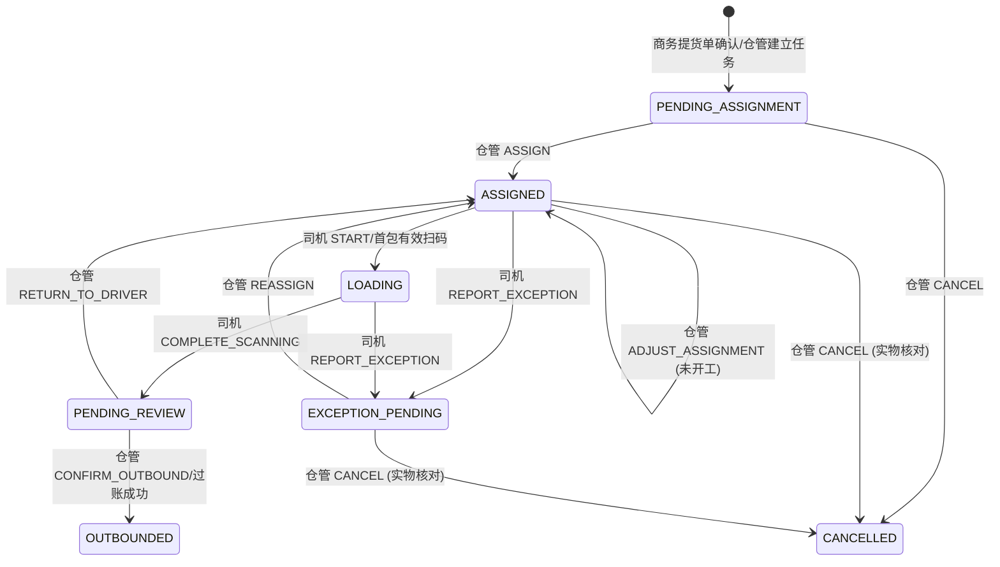

# 出库装车状态机与角色权限规格（C1）

版本：2026-09-22。本文固化目标业务和状态规则；C2 已建立装车任务等数据结构，业务接口、Web/PDA 页面及新任务库存事务仍属于 C3-C6。不得把本文或既有出库扫码页当作现场装车闭环已验收的证据。

## 1. 现场原则与单据边界

1. 商务/销售提供并确认提货单，写明客户、关联订单、计划品种/数量或吨数、提货时间、车辆及联系人等实际已知信息。生产任务已知客户，不要求生产端补录订单号、合同号或库存归属类型。提货单与生产任务客户必须核对；客户不符时不允许派单。
2. 仓管员依据提货单、可用库存及库位地图，选定具体 PCS 包码、当前库位和执行司机，生成**一次装车任务**。同次提货即使涉及多个型号、炉号、炉层或库位，也不自动拆为司机要逐组操作的若干任务；任务内逐包保留这些属性供校验和查看。
3. 司机 PDA 只接收分配给自己的任务，优先看库位、客户、型号、炉号/炉层、目标包数和重量、已扫/剩余；到位连续扫包、提交完成或报告异常。司机不能自行选货、换货、修改库位、变更计划数量或确认出库。
4. 仓管员复核实际已装包码及提货单后确认出库。库存扣减、PCS 出库状态、库位占用释放、出库流水必须在同一成功事务中发生；确认失败不得部分过账。装车扫描只锁定/标记待出库，不代表库存已扣减。
5. 商务可以提出变更或撤回提货单，但已派或执行中的任务不因单据变更自动消失。仓管员须先处理实物和已扫包，才可调整或取消任务；已出库只能走有权限的冲销流程，不能把装车任务改成“已取消”。

## 2. 与现有实现的关系

当前 `RdOutboundOrderServiceImpl` 以销售订单履约/库存批次建立出库单，支持 `DRAFT -> SCANNING -> SUBMITTED -> APPROVED -> POSTED`。扫码会把 PCS 从 `IN_STOCK` 改成 `OUTBOUND_PENDING`，过账时才扣减库存并写流水；审核人不得与提交人相同。现有接口并无商务提货单、仓管选具体包派车、司机本人任务及装车异常的完整关联，不能直接将 `SCANNING` 解释为现场“装车中”。

新装车任务作为现场执行单，关联提货单及所选 PCS；现有出库单仍作为库存和订单履约过账载体。一次装车任务可以关联多个履约批次/出库单，不能因现有“一个出库单关联一个履约/库存批次”的结构强迫司机按炉层分组操作。C2 已确定任务与出库单的映射及唯一占用约束，C5 再接入业务事务；接入前不改变旧出库 API 行为。司机提交装车与仓管复核可以分别成为出库单提交人和审核人，保留现有“提交、审核不得同人”约束；仓管确认后由受控事务过账，不能绕过审核或给司机过账权限。

## 3. 七个任务状态

- `PENDING_ASSIGNMENT`（待派单）：已收到有效提货单并建立任务候选，尚未选定完整 PCS、库位和司机；仅仓管可派单或取消。
- `ASSIGNED`（已派单）：仓管已锁定计划包并指定司机，任务已同步 PDA；未开始扫码时仓管可调整派单。司机可开始或报告找不到货等异常。
- `LOADING`（装车中）：司机开始执行，首个有效扫码也可自动开始；可继续连续扫包或报异常。此时不能直接改派或取消。
- `PENDING_REVIEW`（待复核）：司机确认全部计划包已装并提交，等待仓管核对包码、数量/重量、客户及车辆。库存仍未扣减；仓管可确认出库或说明原因退回司机。
- `OUTBOUNDED`（已出库）：仓管复核且库存事务成功过账。终态，任何补救走原单冲销和审计，不回退任务状态。
- `EXCEPTION_PENDING`（异常待处理）：司机报告现场异常，暂停后续扫码；仓管核实后调整计划并重派，或核对已装实物后取消。已扫进度和异常记录保留。
- `CANCELLED`（已取消）：仓管确认未过账且已装/已扫实物已对齐后的终态；不得保留有效占用或待出库标记。

## 4. 状态转换

每个动作的执行岗位在 `RdLoadingTaskActionEnum` 固定；`RdLoadingTaskStatusMachine` 对状态和岗位同时校验。仓管调整派单是自环，但必须记录版本、变更前后内容、原因和重新同步时间。只有状态机允许动作还不够，服务层仍须检查登录身份、任务归属、有效提货单、包占用、库存/库位版本及物理对账；这些是 C2-C6 的实现条件。

具体动作前置条件：

- `ASSIGN`：提货单有效；选定包均在库、客户/型号及计划要求匹配、未被其他有效装车任务占用；当前库位可用；司机有效。派单后生成不可随意改写的任务版本和包清单。
- `ADJUST_ASSIGNMENT`：仅已派单且尚无有效扫码；仓管说明变更原因，重新校验包和库位，再同步司机。
- `START`：当前登录司机为受派人，任务版本仍有效；首包成功扫码可自动触发，不增加额外按钮负担。
- `COMPLETE_SCANNING`：司机主动提交；有效扫描包集合与当前计划包集合一致，无重复、错包、未处理异常；核对总包数和重量后转待复核，不自动出库。
- `REPORT_EXCEPTION`：司机提交异常类型及说明，保留已扫记录，冻结扫码与提交。异常涉及库位变化时司机只能报告，最终位置仍由仓管核定。
- `REASSIGN`：仓管处理异常并核对已扫/已装实物；变更包、库位或司机时写计划版本和原因，司机 PDA 收到更新。旧扫描在新版本中需逐包复核，不能无条件沿用。
- `RETURN_TO_DRIVER`：仓管退回待复核任务并说明差异；已扫记录保留，但重新提交前必须校验计划版本及现场实物。
- `CONFIRM_OUTBOUND`：仓管复核提货单、任务、实扫包和车辆，提交人/审核人不同；以包码唯一约束、行锁/版本和幂等键执行出库单审核/过账，成功后才置已出库。
- `CANCEL`：仓管确认提货单变更或撤回、未发生过账，并使已扫包状态/实物及占用恢复一致。装车中或待复核不能直接取消，须先报异常或退回、完成对账。

## 5. 岗位和页面边界

- 商务/销售：提交、修订、撤回提货单，查看装车/出库进度；无扫码、选库位、包码替换、库存过账权限。提货单是任务来源，不是“商务操作装车任务状态”的权限。
- 仓管员：查看库存/库位地图与提货单，选包派司机，处理异常/变更，复核并确认出库；负责实际库位和库存真实性。
- 叉车司机：只看本人任务及只读库位/货物资料；连续扫包、提交装车完成、报异常。PDA 不提供任意包选择或最终库位修改入口。
- 系统：校验包归属、客户/型号、计划包、库位、并发占用和数量；按事务同步任务、出库单、PCS、库存批次、库位占用、流水与审计。系统不代替岗位决定换货或出库放行。

Web/PDA 菜单按岗位给入口，接口按具体动作授权且校验任务归属；不能仅用页面隐藏按钮作为权限。审计/只读岗位只能查询。

## 6. 扫包、数量和库位规则

1. 一次任务是一张现场装车单，包明细逐包记录客户、型号、炉号、炉层、净重及计划库位。PDA 默认按库位提示取货，可筛选/查看，但不强制拆成多个装车小组。
2. 扫码以唯一 PCS 包码或本地数字链接解析结果为准，必须属于当前任务及最新有效计划版本。不同炉层可以同任务，但扫错客户/型号/炉号/炉层或扫到其他包必须拒绝并留痕。
3. 司机可连续扫多包；重复扫码/网络重试只返回“已扫”，不能重复计数、重复占用或重复扣库存。扫到非任务包、已出库包、冻结库位包均拒绝。
4. 计划库位与实际找货位置不符时司机报告异常。仓管核实后更新系统最终库位或装车计划并重派；不得由司机端隐式改库位。
5. 提货单按吨数发货时，计划包数与实扫净重同时展示；短装、超装、换包只由仓管与商务核对并变更计划后继续。不能把重量四舍五入当成已扫包的依据。
6. 派单时应检查同一包只能处于一个有效装车任务，并检查销售订单可履约量；最终过账还要重新检查，不依赖过期页面数据。

## 7. 异常和回退

常见异常：计划库位缺货、货被挪动、库位冻结、错包/错客户/错型号、标签损坏、扫码失败、车辆临时变更、少装或多装、提货单撤回。司机记录事实，不自行换包。仓管可核实库位、补扫、换包、改派司机或取消；涉及客户/吨数变化先取得商务更新后的提货单。每次处理保留原包清单和版本历史。

若过账中任一包失败，整笔确认事务回滚，任务仍待复核并提示仓管；已出库后只能走原出库单冲销或退货流程，不能重扫同任务，也不能直接取消任务。

## 8. C2-C6 落地约束与验收

- C2：已建立提货单引用、装车任务/包明细、扫描/异常记录及与现有出库单的关系；明确一任务多出库单的原子过账与唯一有效占用约束。数据结构不等于业务过账已实现。
- C3：仓管 Web 端按提货单和库位地图选具体包、派司机，任务整体展示而不是按炉层强拆小组。
- C4：司机 PDA 只读任务位置和货物资料，支持扫码枪连续输入及本人任务隔离。
- C5：将扫码、异常、退回、复核和最终库存过账接入持久化事务；不得直接复用旧出库扫码页跳过任务包校验。
- C6：验证不同岗位 `403`、同包并发争用、重复确认幂等、扫描和库存/库位一致性、全链路操作日志。

本地 C1 验证为状态机单测及规格复核；真实提货单样本、岗位账号、现场 PDA/扫码枪、库位准确性和签字验收留 F 阶段，不以模拟数据替代。
