# 瑞鼎 ERP 全业务详细逻辑架构

_基于当前已实现的生产库存订单闭环，扩展采购、原材料仓、生产领退料、成品入库与销售出库全流程，更新日期：2026-07-13_

---

## 1. 文档目标与范围

本文件是后续业务确认、数据库设计、接口开发、页面开发、权限配置和验收测试的统一逻辑基线。系统需要同时管理四条相互关联但不能混淆的主线：

1. **单据流**：销售订单、采购订单、收货单、领料单、生产记录、质检单、入库单、调拨单、出库单和盘点单的状态变化。
2. **实物流**：原材料、在制品、成品吨包从供应商到原料仓、生产现场、成品仓和客户的真实移动。
3. **库存账**：每次审核过账后形成不可删除的库存流水，并同步更新批次汇总账和单包明细账。
4. **责任流**：制单、提交、审核、复核、过账和撤销必须记录具体人员与时间，高风险业务实行制单人与审核人分离。

### 当前边界与目标边界

| 业务域                             | 当前状态 | 本架构中的处理                               |
| ---------------------------------- | -------- | -------------------------------------------- |
| 销售订单、订单拆分、生产实绩       | 已实现   | 保留并补充上下游关系                         |
| 一包一码、成品质检、成品入库       | 已实现   | 作为成品仓核心闭环                           |
| 成品库存、订单匹配、调拨、扫码出库 | 已实现   | 保留现有字段和计算规则                       |
| 库存盘点、库存动态明细、日报       | 已实现   | 纳入统一账务和审计规则                       |
| 供应商、采购订单、到货收货         | 规划     | 下一阶段新增采购与收货模块                   |
| 原材料质检、原材料批次库存         | 规划     | 下一阶段新增原材料仓模块                     |
| BOM、生产工单、领料、退料、补料    | 规划     | 下一阶段新增生产物料闭环                     |
| 财务应付、应收和成本凭证           | 规划接口 | 首期只保留业务数据和对账接口，不直接建设总账 |

> 当前项目的事实来源仍是现有代码、干净数据库基线和各阶段验收记录。本文中的“规划”内容不得被描述为已经上线。

## 2. 全业务逻辑总览

```mermaid
flowchart LR
    accTitle: 瑞鼎 ERP 全业务主链
    accDescr: 从销售需求、采购进货、原材料入库、生产领料，到成品质检入库、订单匹配、调拨、出库和结案的完整业务链路

    demand([销售需求]) --> sale_order[销售订单]
    sale_order --> split_plan[订单拆分与生产计划]
    split_plan --> material_plan[物料需求计划]

    subgraph purchase_stage [采购与原料到货]
        material_plan --> purchase_order[采购订单]
        purchase_order --> receipt_order[到货收货]
        receipt_order --> incoming_qc{来料质检合格?}
        incoming_qc -->|否| supplier_return[退供应商或待处理]
        incoming_qc -->|是| raw_inbound[原材料入库过账]
    end

    subgraph production_stage [生产执行]
        raw_inbound --> material_issue[按工单领料]
        material_issue --> production_exec[投炉与生产执行]
        production_exec --> production_output[炉号炉层实绩确认]
        production_output --> package_generate[拆包并生成包码]
    end

    subgraph finished_stage [成品质检与入库]
        package_generate --> finished_qc{成品质检合格?}
        finished_qc -->|否| nonconforming[返工或不合格品]
        finished_qc -->|是| finished_inbound[成品入库复核过账]
        finished_inbound --> finished_stock[成品库存]
    end

    subgraph delivery_stage [订单交付]
        finished_stock --> order_allocate[订单匹配与锁定]
        order_allocate --> stock_transfer[订单间调拨]
        order_allocate --> outbound_scan[扫码拣货与出库复核]
        stock_transfer --> outbound_scan
        outbound_scan --> outbound_post[出库过账]
        outbound_post --> order_close{生产与交付均完成?}
        order_close -->|是| closed([订单关闭])
        order_close -->|否| sale_order
    end

    finished_stock --> stocktake[按货位库存盘点]
    stocktake --> finished_stock

    classDef current fill:#dcfce7,stroke:#16a34a,stroke-width:2px,color:#14532d
    classDef planned fill:#dbeafe,stroke:#2563eb,stroke-width:2px,color:#1e3a5f
    classDef decision fill:#fef9c3,stroke:#ca8a04,stroke-width:2px,color:#713f12
    classDef exception fill:#fee2e2,stroke:#dc2626,stroke-width:2px,color:#7f1d1d

    class sale_order,split_plan,production_output,package_generate,finished_qc,finished_inbound,finished_stock,order_allocate,stock_transfer,outbound_scan,outbound_post,order_close,closed,stocktake current
    class material_plan,purchase_order,receipt_order,raw_inbound,material_issue,production_exec planned
    class incoming_qc,finished_qc,order_close decision
    class supplier_return,nonconforming exception
```

总流程必须遵守一个硬规则：**只有过账改变库存，保存、提交、审核和扫码都不能直接改变库存数量。** 扫码可以锁定单包，审核可以允许过账，但库存增减只能在过账事务成功后生效。

## 3. 部门与岗位责任架构

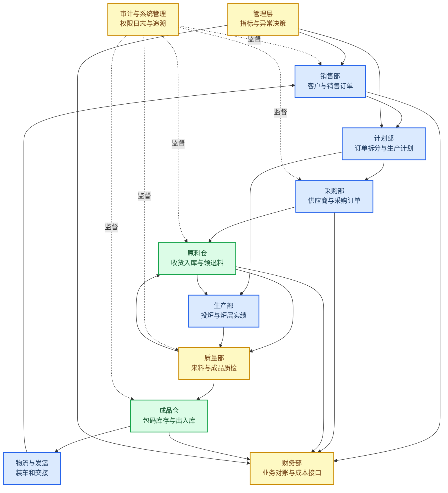

| 部门或岗位   | 主要输入                   | 核心动作                             | 主要输出                     | 不允许执行                 |
| ------------ | -------------------------- | ------------------------------------ | ---------------------------- | -------------------------- |
| 销售部       | 客户需求、合同、交期       | 创建销售订单、确认客户型号和应入数量 | 有效销售订单、发运要求       | 直接改库存或审核仓库单据   |
| 计划部       | 销售订单、库存、产能       | 订单拆分、物料需求、生产排程         | 生产计划、采购建议、工单     | 伪造生产实绩或替代质检     |
| 采购部       | 物料需求、供应商资料       | 询价、下单、跟催、变更和关闭         | 采购订单、到货计划           | 直接确认收货数量或质检结论 |
| 原料仓操作岗 | 送货单、采购订单           | 收货扫码、称重、暂存、上架、领退料   | 收货单、原料入库单、领退料单 | 审核本人单据或绕过质检入库 |
| 来料质检岗   | 待检批次、质量标准         | 取样、检测、判定和复检               | 合格、让步接收或不合格结论   | 修改采购数量或库存数量     |
| 生产部       | 工单、配方、领料单         | 投炉、生产、记录炉号炉层和产量       | 生产实绩、退料、损耗记录     | 未确认实绩直接生成库存     |
| 成品质检岗   | 包码、生产实绩、质量标准   | 检测、提交、审核、驳回和复检         | 包码质检结论                 | 审核本人提交的质检单       |
| 成品仓操作岗 | 合格包码、入库单、出库任务 | 扫码复核、上架、拣货、盘点           | 入库明细、出库明细、盘点明细 | 直接修改已过账库存         |
| 仓库管理岗   | 已提交仓库单据             | 复核、审核、过账和反向撤销           | 正向或反向库存流水           | 删除历史流水或审核本人单据 |
| 物流岗       | 已审核出库单               | 装车、交接、记录车辆和签收           | 发运记录、签收凭证           | 代替仓库扣减库存           |
| 财务部       | 采购收货、销售出库、退货   | 三单核对、应付应收和成本对账         | 对账结果、财务接口数据       | 直接修改业务数量           |
| 审计与管理员 | 用户、角色、日志、异常单据 | 权限配置、操作追溯、备份恢复         | 审计记录、异常处置结论       | 绕过状态机直接改业务表     |

## 4. 基础资料与编码关系

完整流程运行前必须先统一基础资料，否则同一种物料、客户或型号会在各部门形成多个名称，最终无法对账。

| 基础资料     | 必填字段                                       | 使用环节                       | 当前状态                       |
| ------------ | ---------------------------------------------- | ------------------------------ | ------------------------------ |
| 客户型号关系 | 客户、型号、启用状态                           | 销售订单、生产、库存、出库     | 已实现 `rd_customer_product`   |
| 成品资料     | 产品编码、名称、客户、型号、默认包重、质量标准 | 生产、标签、质检、成品仓       | 已实现 `rd_product_master`     |
| 仓库货位     | 仓库、库区、货位、容量、状态、允许类别         | 原料入库、成品入库、调拨、盘点 | 已实现成品货位，需扩展仓库层级 |
| 炉层资料     | 炉层编码、名称、顺序、启用状态                 | 订单拆分、生产实绩             | 已实现 `rd_furnace_layer`      |
| 供应商资料   | 编码、名称、税号、联系人、供货物料、质量等级   | 采购、收货、来料质检           | 规划 `rd_supplier`             |
| 原材料资料   | 物料编码、名称、规格、单位、批次规则、保质期   | 采购、原料仓、领料             | 规划 `rd_material_master`      |
| BOM 或配方   | 成品型号、原料、标准用量、损耗率、版本、生效期 | 物料需求、领料、成本           | 规划 `rd_bom`、`rd_bom_line`   |
| 质量标准     | 检验类型、项目、上下限、单位、抽样方案、版本   | 来料质检、成品质检             | 成品质检已有项目字段，需资料化 |
| 原因字典     | 退货、驳回、补打、调整、撤销、盘盈盘亏原因     | 全流程审计                     | 需统一字典管理                 |

建议编码规则：

| 对象     | 示例                     | 规则                             |
| -------- | ------------------------ | -------------------------------- |
| 采购订单 | `PO202607130001`         | `PO + 日期 + 4位流水`            |
| 收货单   | `RC202607130001`         | `RC + 日期 + 4位流水`            |
| 原料批次 | `RM-物料编码-供应商批号` | 保留供应商批号并生成内部批次     |
| 生产工单 | `MO202607130001`         | `MO + 日期 + 4位流水`            |
| 领料单   | `MI202607130001`         | `MI + 日期 + 4位流水`            |
| 生产炉号 | 沿用现场炉号             | 不由系统擅自改写，只校验唯一范围 |
| 成品包码 | 沿用当前日序列规则       | 二维码只存包码，业务字段实时查询 |
| 入库单   | `IN202607130001`         | `IN + 日期 + 4位流水`            |
| 出库单   | `OUT202607130001`        | `OUT + 日期 + 4位流水`           |

## 5. 采购进货与原材料入库

### 5.1 采购业务流程

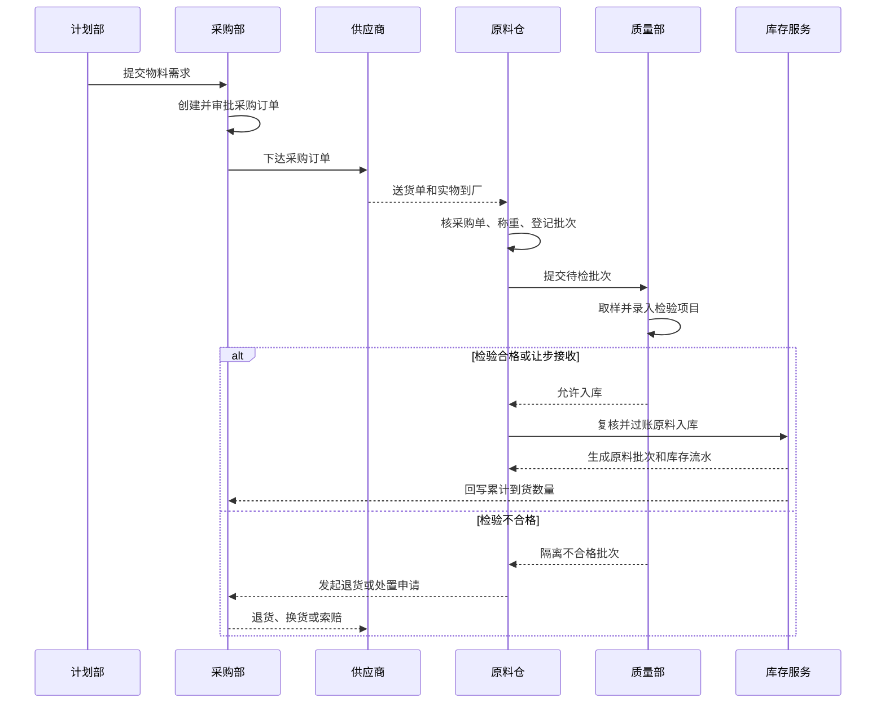

### 5.2 单据链与字段

| 单据       | 制单部门       | 审核部门         | 关键字段                                             | 过账影响               |
| ---------- | -------------- | ---------------- | ---------------------------------------------------- | ---------------------- |
| 采购申请   | 计划部         | 计划负责人       | 物料、需求量、需求日期、用途、来源订单               | 无库存影响             |
| 采购订单   | 采购部         | 采购负责人       | 供应商、物料、规格、订单量、单价、交期、税率         | 无库存影响             |
| 收货单     | 原料仓         | 仓库复核岗       | 采购单、供应商批号、实收量、毛重、皮重、净重、暂存位 | 仅形成待检数量         |
| 来料质检单 | 质量部         | 质量审核岗       | 收货批次、检验项目、检测值、结论、驳回原因           | 合格后允许入库         |
| 原料入库单 | 原料仓         | 仓库管理岗       | 收货单、内部批次、货位、合格数量、重量               | 增加原料库存           |
| 采购退货单 | 原料仓或采购部 | 采购与质量负责人 | 原批次、退货数量、原因、供应商                       | 减少原料库存或待检数量 |

### 5.3 数量控制

- `采购未到量 = 采购订单量 - 累计合格入库量 - 累计退货关闭量`
- `收货待检量 = 实收量 - 已检量 - 收货拒收量`
- `质检合格量 + 不合格量 + 待判定量 = 实收量`
- `原料可用量 = 原料在库量 - 已锁定量 - 冻结量 - 质检隔离量`
- 采购订单允许分批到货，但累计合格入库量不得无审批超过订单允许超收比例。
- 没有采购订单的临时到货只能进入“无订单待处理区”，不能直接形成可用库存。

## 6. 原材料仓储与生产领退料

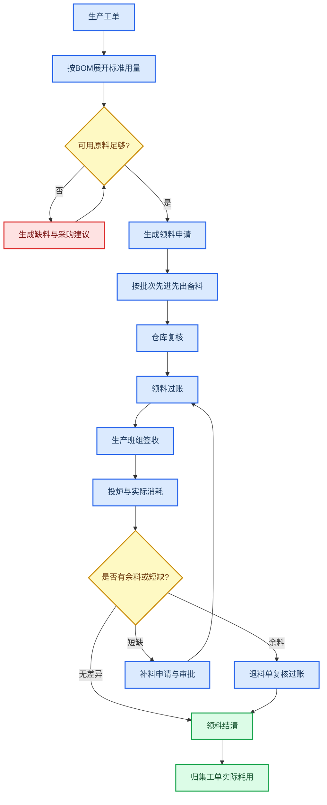

领料必须绑定生产工单、物料批次和领用部门。原料仓不能只记录“出库总数”，必须知道哪一批原料发给哪一个工单、炉号或生产班组，才能计算批次追溯和实际耗用。

| 业务     | 原料库存 | 在制物料 | 关键校验                         |
| -------- | -------: | -------: | -------------------------------- |
| 领料过账 |     减少 |     增加 | 工单有效、批次合格、可用量足够   |
| 退料过账 |     增加 |     减少 | 原领料来源明确、退料质量状态有效 |
| 补料过账 |     减少 |     增加 | 超BOM用量必须填写原因并审批      |
| 报废确认 |   不回仓 |     减少 | 记录报废原因、责任和重量         |
| 工单结案 |     不变 |     清零 | 已领、已退、已耗、报废四项平衡   |

物料平衡公式：

`工单实际耗用 = 累计领料 - 累计退料 - 可回收余料`

`工单物料差异 = 工单实际耗用 - BOM标准耗用`

`原料库存结存 = 期初 + 采购入库 + 调拨入 + 生产退料 + 调增 - 领料 - 调拨出 - 采购退货 - 调减`

## 7. 订单拆分、生产执行与生产实绩

### 7.1 当前已实现关系

```mermaid
flowchart LR
    accTitle: 销售订单到生产实绩
    accDescr: 销售订单按客户型号规则拆分到炉层计划，生产完成后确认实绩并绑定拆分结果，最终回算订单实际产额

    sale_order[销售订单<br/>应入数量] --> split_rule[拆分规则<br/>装炉量与成品率]
    split_rule --> split_trial[拆分试算]
    split_trial --> manual_adjust[炉层人工修正]
    manual_adjust --> split_confirm[确认拆分计划]
    split_confirm --> production_execute[生产执行]
    production_execute --> output_draft[炉层产量草稿]
    output_draft --> output_confirm[确认生产实绩]
    output_confirm --> match_check{客户型号炉号炉层一致?}
    match_check -->|否| reject_bind[禁止绑定并提示差异]
    match_check -->|是| output_bind[绑定拆分结果]
    output_bind --> metric_recalc[回算订单产额与差额]
    metric_recalc --> package_generate[按实绩生成包码]

    classDef current fill:#dcfce7,stroke:#16a34a,stroke-width:2px,color:#14532d
    classDef decision fill:#fef9c3,stroke:#ca8a04,stroke-width:2px,color:#713f12
    classDef exception fill:#fee2e2,stroke:#dc2626,stroke-width:2px,color:#7f1d1d

    class sale_order,split_rule,split_trial,manual_adjust,split_confirm,production_execute,output_draft,output_confirm,output_bind,metric_recalc,package_generate current
    class match_check decision
    class reject_bind exception
```

拆分计划只回答“计划各炉层生产多少”，不会创建包码、不会增加库存，也不会直接增加订单实际产额。只有生产实绩确认并与拆分结果建立有效绑定后，才计入订单的拆分绑定产额。

### 7.2 当前订单计算规则

| 字段         | 公式                                                   | 业务含义                         |
| ------------ | ------------------------------------------------------ | -------------------------------- |
| 人工产额     | 人工录入                                               | 历史或特殊场景的人工实绩         |
| 拆分绑定产额 | 有效生产绑定的实绩汇总                                 | 来自已确认生产炉层产量           |
| 实际总产额   | `人工产额 + 拆分绑定产额`                              | 订单当前实际生产量               |
| 生产差额     | `应入数量 - 实际总产额`                                | 不考虑库存匹配和调拨的生产缺口   |
| 已完成数量   | `实际总产额 + 已分配库存 + 调入数量 - 调出数量`        | 当前订单可用于满足需求的总数量   |
| 调整后差额   | `应入数量 - 已完成数量`                                | 考虑库存分配和订单间调拨后的缺口 |
| 生产满足     | `已完成数量 >= 应入数量`                               | 状态进入 `FULFILLED`             |
| 订单关闭     | `已完成数量 >= 应入数量` 且 `累计过账出库 >= 应入数量` | 状态进入 `CLOSED`                |

### 7.3 A、B订单调拨逻辑

当 A 订单缺 20 包、B 订单有 20 包可转用时：

1. 调拨单必须指定来源订单 B、目标订单 A、来源库存批次和具体包码。
2. 型号必须一致；客户归属按调拨后的业务规则更新，但原包码和原批次关系必须保留。
3. 确认调拨后，B 的 `调出数量 +20`，A 的 `调入数量 +20`。
4. 来源批次数量减少，目标批次数量增加，全仓总包数和总重量不变。
5. A 的已完成数量实时重算；达到应入数量后进入生产满足状态，但必须完成实际出库后才关闭。
6. 如果调入包码已被订单锁定、出库或后续调拨，原调拨单不得直接撤销。

## 8. 一包一码、成品质检与成品入库

### 8.1 包码生命周期

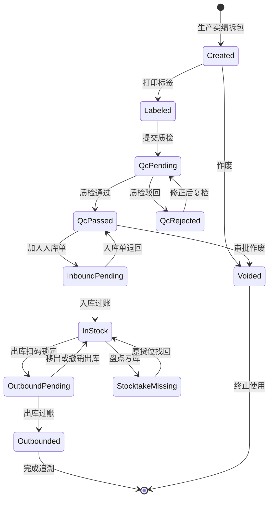

### 8.2 质检与入库控制

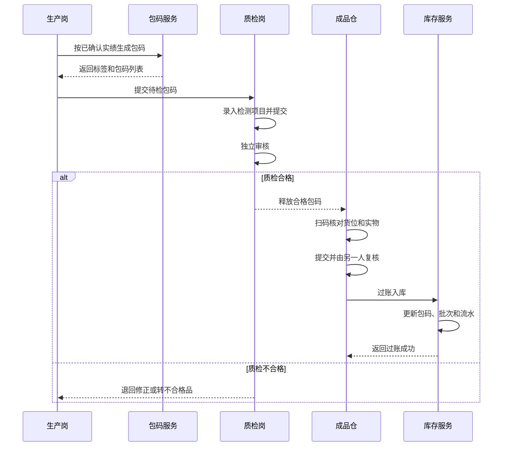

入库过账必须在一个数据库事务内同时完成：

- 包码状态从 `INBOUND_PENDING` 变为 `IN_STOCK`
- 包码写入唯一货位和库存批次
- `rd_stock_lot` 增加库房数量与入库数量
- `rd_stock_transaction` 写入 `PRODUCTION_IN` 流水
- 生产实绩累计入库数量增加
- 入库单状态变为 `POSTED`
- 使用唯一幂等键阻止重复过账

## 9. 成品库存、调拨与盘点

### 9.1 三层库存账

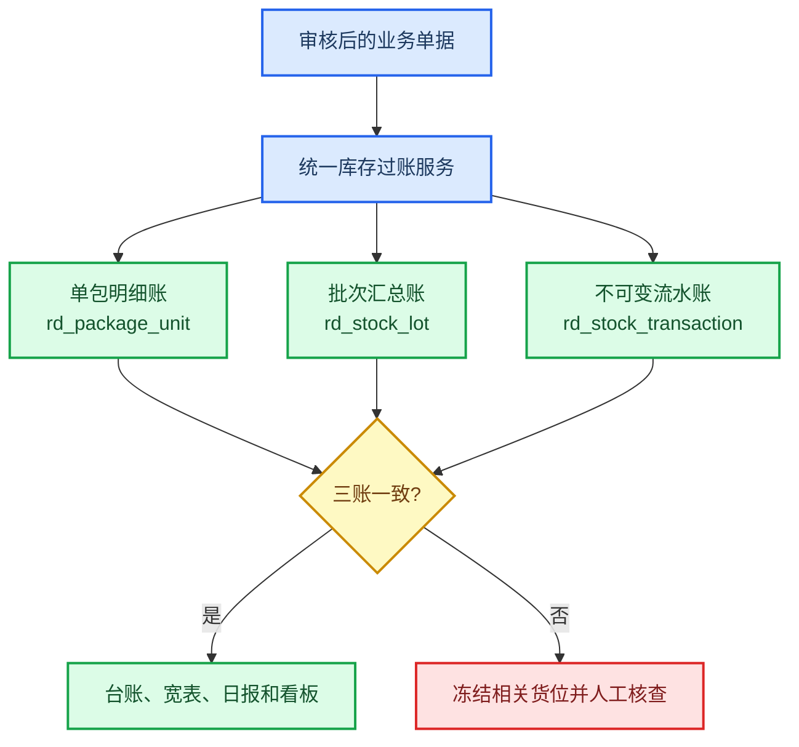

库存批次维度保持为：

`货位 + 客户 + 型号 + 生产炉号 + 所在炉层 + 库存类型 + 单包重量 + 批次`

当前成品库存公式：

`库房数量 = 期初 + 生产入库 + 普通入库 + 调拨入 + 退货入库 + 调增 - 出库 - 调拨出 - 调减`

`锁定数量 = 已匹配或已扫描但尚未完成出库的数量`

`可用数量 = 库房数量 - 锁定数量`

`库存重量 = 库房数量 × 单包重量`

当现场存在非标准包重时，重量应以每个 `rd_package_unit.package_weight` 求和为准，批次乘法只作为快速汇总和校验值。

### 9.2 调拨规则

| 调拨类型     | 来源变化         | 目标变化         | 全仓总量 | 订单影响             |
| ------------ | ---------------- | ---------------- | -------- | -------------------- |
| 货位调拨     | 来源货位减少     | 目标货位增加     | 不变     | 不变                 |
| 订单调拨     | 来源订单调出增加 | 目标订单调入增加 | 不变     | 两张订单实时重算     |
| 客户归属调拨 | 原客户批次减少   | 新客户批次增加   | 不变     | 必须保留包码原始追溯 |
| 撤销调拨     | 生成反向流水     | 恢复原包码和批次 | 不变     | 仅后续未占用时允许   |

### 9.3 盘点流程

盘点按货位冻结，不执行全仓停库：

`DRAFT -> FROZEN -> COUNTING -> SUBMITTED -> APPROVED -> ADJUSTED -> CLOSED`

| 环节 | 系统动作                   | 控制要求                             |
| ---- | -------------------------- | ------------------------------------ |
| 冻结 | 生成货位包码快照并锁定货位 | 该货位禁止入库、出库、调拨和订单占用 |
| 实盘 | 扫描现场包码               | 重复包码、跨货位包码立即提示         |
| 提交 | 计算账面与实盘差异         | 提交人不能审核本人盘点单             |
| 审核 | 确认盘盈盘亏原因           | 不通过则退回继续盘点                 |
| 调整 | 逐包生成幂等调整流水       | 盘亏后数量不得低于已锁定量           |
| 关闭 | 释放货位冻结               | 保留快照、扫描和调整历史             |

## 10. 订单匹配、扫码出库与订单关闭

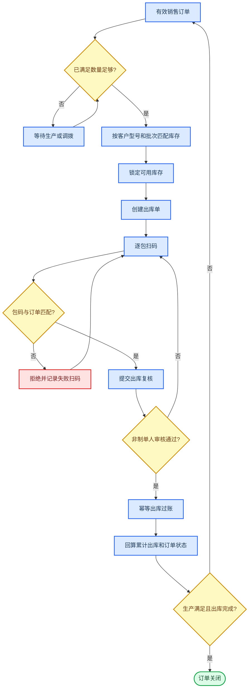

出库单状态为：

`DRAFT -> SCANNING -> SUBMITTED -> APPROVED -> POSTED -> REVERSED`

出库过账在一个事务内完成：包码变为 `OUTBOUNDED`、批次库房数量和锁定数量同步减少、写入 `OUTBOUND` 流水、订单匹配明细累计出库增加、销售订单累计出库和状态重算。

## 11. 退货、撤销与异常处置

已过账数据不得删除。任何纠错都必须形成反向业务单据、反向库存流水和完整原因。

| 异常类型       | 正确处理                 | 库存影响                           | 禁止方式             |
| -------------- | ------------------------ | ---------------------------------- | -------------------- |
| 采购到货不合格 | 收货拒收或采购退货       | 未入库则不增库存；已入库则退货扣减 | 删除收货或入库记录   |
| 生产领料多领   | 生产退料单               | 原料库存增加                       | 直接改原领料数量     |
| 成品质检不合格 | 返工、降级或不合格品处置 | 不进入可用成品库存                 | 强制改为合格         |
| 入库单错误     | 校验后反向撤销           | 生成反向入库流水                   | 删除入库流水         |
| 客户退货       | 退货收货、复检、退货入库 | 合格后生成 `RETURN_IN`             | 直接加库存数量       |
| 出库单错误     | 校验后反向撤销           | 恢复包码、批次、锁定和订单履约     | 删除出库单           |
| 调拨错误       | 反向调拨                 | 恢复来源和目标批次                 | 后续已占用仍强制撤销 |
| 盘点差异       | 盘点审核后调整           | `ADJUST_IN` 或 `ADJUST_OUT`        | 仓管手工改数据库     |

撤销前必须依次校验：原业务单已过账、未重复撤销、目标库存仍可恢复、包码未被后续业务占用、相关货位未被其他盘点冻结、当前操作人具有撤销权限。

## 12. 核心单据状态机

| 单据             | 状态链                                                                       | 终止状态                    |
| ---------------- | ---------------------------------------------------------------------------- | --------------------------- |
| 采购订单（规划） | `DRAFT -> SUBMITTED -> APPROVED -> PART_RECEIVED -> RECEIVED -> CLOSED`      | `CLOSED/CANCELLED`          |
| 收货单（规划）   | `DRAFT -> RECEIVED -> QC_PENDING -> QC_PASSED -> INBOUND_PENDING -> POSTED`  | `POSTED/REJECTED/CANCELLED` |
| 领料单（规划）   | `DRAFT -> SUBMITTED -> APPROVED -> PICKING -> POSTED`                        | `POSTED/REVERSED/CANCELLED` |
| 生产实绩         | `DRAFT -> CONFIRMED -> INBOUNDED`                                            | `INBOUNDED/CANCELLED`       |
| 质检单           | `DRAFT -> SUBMITTED -> PASSED/REJECTED -> CORRECTED -> RESUBMITTED`          | `PASSED/REJECTED`           |
| 成品入库单       | `DRAFT -> SUBMITTED -> VERIFIED -> POSTED -> REVERSED`                       | `POSTED/REVERSED`           |
| 订单匹配         | `MATCHED -> ALLOCATED -> OUTBOUNDED`                                         | `OUTBOUNDED/CANCELLED`      |
| 调拨单           | `DRAFT -> CONFIRMED -> CANCELLED`                                            | `CONFIRMED/CANCELLED`       |
| 出库单           | `DRAFT -> SCANNING -> SUBMITTED -> APPROVED -> POSTED -> REVERSED`           | `POSTED/REVERSED/CANCELLED` |
| 盘点单           | `DRAFT -> FROZEN -> COUNTING -> SUBMITTED -> APPROVED -> ADJUSTED -> CLOSED` | `CLOSED/CANCELLED`          |
| 销售订单         | `OPEN -> PARTIAL -> FULFILLED -> CLOSED`                                     | `CLOSED/CANCELLED`          |

每个状态动作都必须校验：当前状态、操作权限、单据版本号、业务唯一键、制单审核分离、关联数据状态和库存可用量。

## 13. 核心数据架构

### 13.1 采购与原材料域（规划）

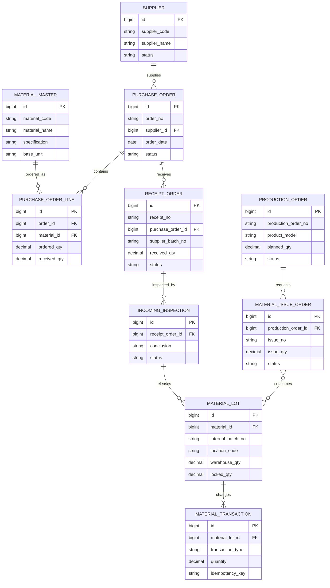

### 13.2 生产、成品库存与订单域（现有）

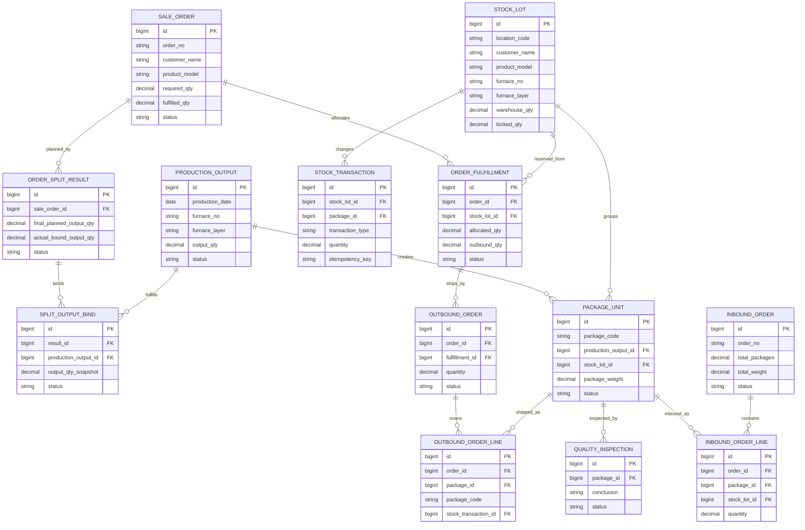

## 14. 统一过账与一致性控制

所有原料和成品库存业务最终都应调用同一个库存领域过账规范，而不是各模块自行拼接更新语句。

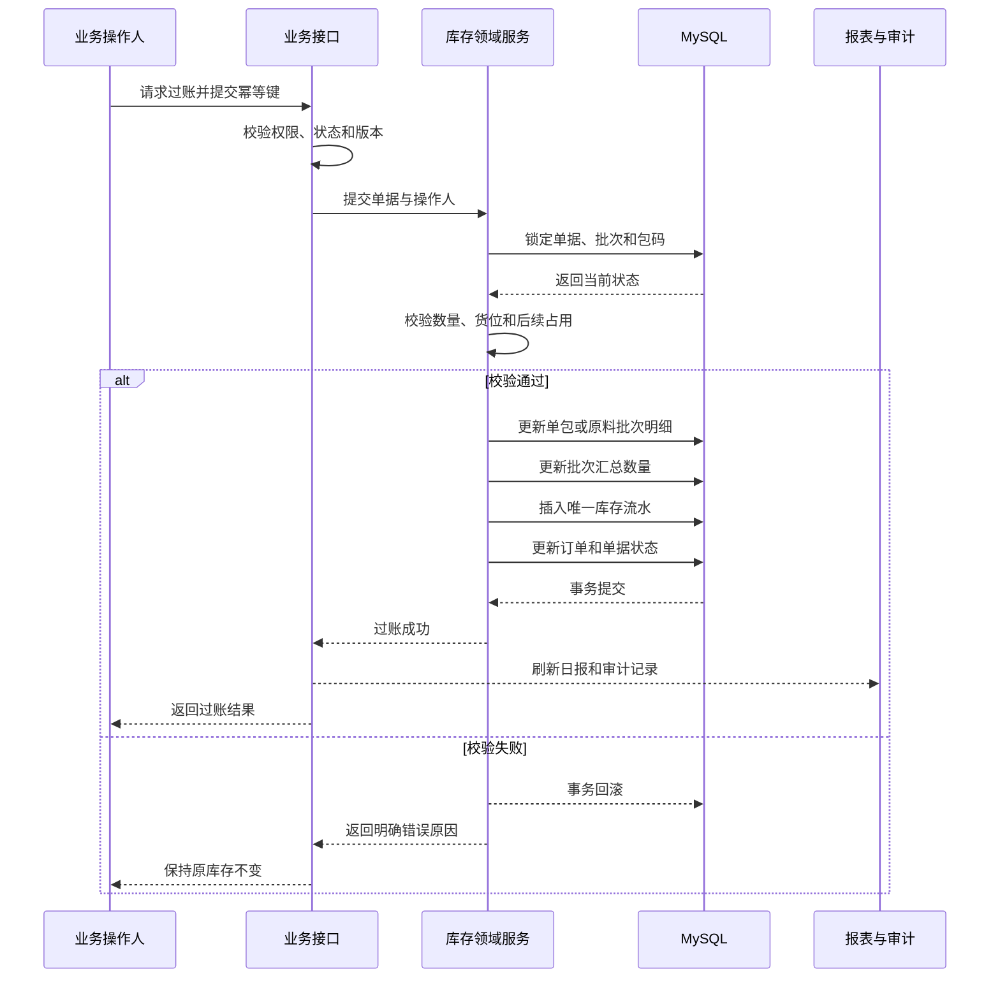

强制技术规则：

- 所有库存写入固定 `tenant_id=1`，但业务代码仍保留租户隔离字段。
- 关键写操作使用数据库事务、行锁或乐观版本号。
- 每次过账使用业务唯一幂等键，重复请求只能返回原结果。
- 库存流水只追加，不更新业务数量，不物理删除。
- 撤销流水通过 `reversal_transaction_id` 指向原流水。
- 包码全局唯一，同一包码只能位于一个有效货位。
- 已冻结货位禁止出入库、调拨、订单占用和手工调整。
- 每日汇总和动态宽表来自流水聚合，不能作为库存事实来源。

## 15. 页面与模块规划

| 一级菜单   | 二级页面                                         | 状态                 | 主要使用部门     |
| ---------- | ------------------------------------------------ | -------------------- | ---------------- |
| 基础资料   | 客户型号、产品资料、仓库货位、炉层资料           | 已实现               | 计划、生产、仓库 |
| 基础资料   | 供应商、原材料、BOM、质量标准                    | 规划                 | 采购、计划、质量 |
| 采购管理   | 采购申请、采购订单、到货计划、采购退货           | 规划                 | 计划、采购       |
| 原料仓管理 | 收货单、来料待检、原料入库、原料库存、领料、退料 | 规划                 | 原料仓、生产     |
| 生产管理   | 生产炉层产量、订单拆分                           | 已实现               | 计划、生产       |
| 生产管理   | 生产工单、物料需求、实际耗用、工单结案           | 规划                 | 计划、生产       |
| 质量管理   | 成品质检录入与审核                               | 已实现               | 质量部           |
| 质量管理   | 来料质检、不合格品、质量标准                     | 规划                 | 质量部           |
| 仓库管理   | 成品入库单、包码库存、库存台账、流水、动态明细   | 已实现               | 成品仓           |
| 仓库管理   | 调拨单、扫码出库、库存盘点                       | 已实现               | 成品仓           |
| 订单管理   | 销售订单、订单匹配、订单拆分                     | 已实现               | 销售、计划、仓库 |
| 报表中心   | 每日出入库、订单差额、库存余额、包码追溯         | 已实现或已有数据基础 | 管理、审计       |
| 报表中心   | 采购到货率、原料库龄、物料耗用差异、批次追溯     | 规划                 | 管理、采购、生产 |

## 16. 分阶段开发顺序

### 第一阶段：原材料基础与采购到货

- 新增供应商、原材料、仓库层级和质量标准资料。
- 新增采购申请、采购订单、分批到货和收货单。
- 新增来料质检、待检区、合格入库和采购退货。
- 建立原料批次账、原料库存流水和采购到货报表。

### 第二阶段：生产工单与领退料

- 新增 BOM 或配方版本、生产工单和物料需求计算。
- 新增领料申请、仓库备料、发料过账、生产签收。
- 新增退料、补料、报废和工单物料平衡。
- 将生产实绩绑定生产工单、实际耗用和来源原料批次。

### 第三阶段：全链追溯与经营分析

- 实现“供应商批次 -> 原料入库 -> 领料 -> 炉号炉层 -> 成品包码 -> 客户出库”的正反向追溯。
- 增加采购到货率、来料合格率、成品合格率、生产成品率、物料耗用差异和库存周转指标。
- 增加财务对账接口、成本归集接口和异常预警。

### 第四阶段：现场设备与正式发布

- 联调扫码枪、电子秤、标签打印机和移动端摄像头。
- 完成百万级流水性能、并发过账、权限矩阵、备份恢复和断网补录测试。
- 先在隔离试运行库导入真实基础资料，再通过盘点初始化原料和成品库存。

## 17. 验收总则

1. 任意库存变化都能追溯到审核后的业务单据、操作人、审核人和库存流水。
2. 任意成品包码都能反查客户、型号、炉号、炉层、生产日期、质检、入库、调拨和出库。
3. 扩展原料模块后，任意成品包码还应反查生产工单、领料单和供应商原料批次。
4. 单包明细数量、批次库存数量和库存流水汇总必须一致。
5. 原料仓和成品仓必须分别核算，不允许共用一个模糊的“库存数量”字段。
6. 保存、提交、审核、扫码和打印均不得直接改变库存，只有过账可以改变库存。
7. 已过账单据不得删除，撤销必须产生反向流水并保留原记录。
8. 制单人不得审核本人高风险单据，越权接口必须返回 `403`。
9. 销售订单生产满足与实际交付必须分别判断，只有两者都满足才允许关闭。
10. 所有数据库升级先在隔离库完成备份恢复、数量核对和幂等验证，再进入试运行环境。

## 18. 现有依据

- [第11周包码、质检与入库闭环开发验收记录](./第11周包码质检入库开发验收记录.md)
- [第12周扫码出库开发验收记录](./第12周扫码出库开发验收记录.md)
- [第13周库存盘点开发验收记录](./第13周库存盘点开发验收记录.md)
- [第14周订单拆分开发验收记录](./第14周订单拆分开发验收记录.md)
- [岗位操作培训手册](./岗位操作培训手册.md)
- [瑞鼎 ERP 瘦身后开发与运维基线](./瑞鼎ERP瘦身后开发与运维基线.md)
